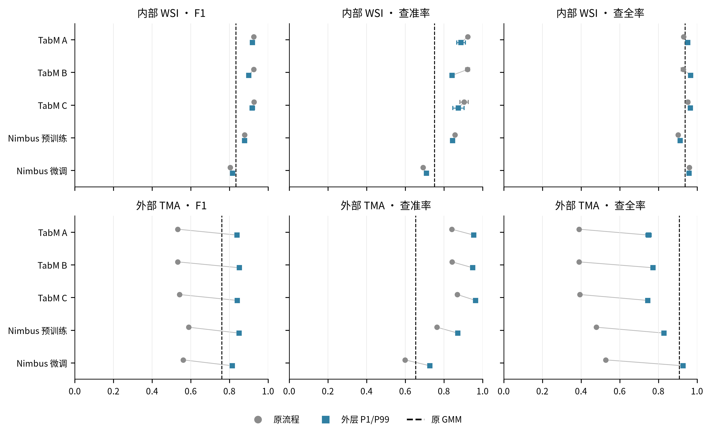
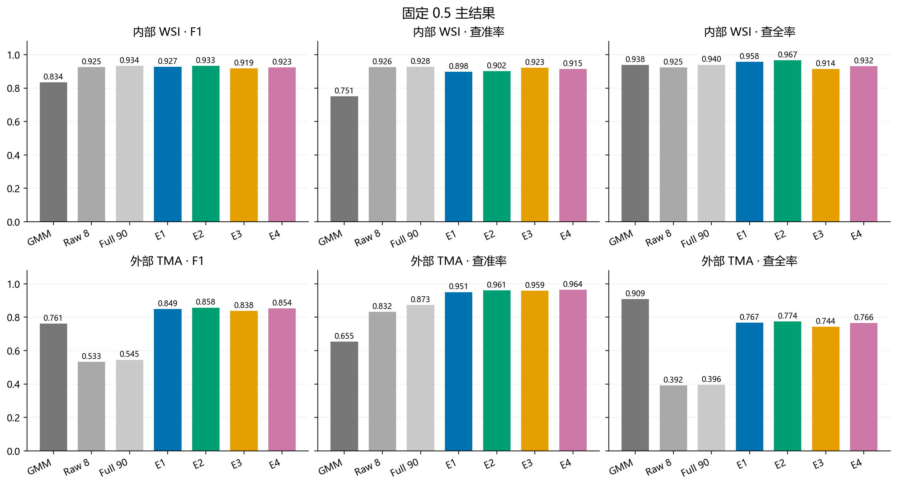

# mIF Marker Positivity — CD8

基于固定实例分割的逐细胞 CD8 阴阳识别：从原始荧光图像提取强度与空间表达特征，比较 SCIMAP GMM、HGB 特征模型、Nimbus 和 TabM。当前研究数据为 **PhenoBIC-Data**。

## Overview

细胞通过 `dataset_id + image_id + cell_id + marker` 对齐；沿用官方训练、内部验证与外部 TMA 划分。mask 为 **expanded_nucleus**，边缘只代表近似细胞边缘。原始数据、权重和全量逐细胞结果保存在研究服务器；本仓库提供可读代码、固定配置、中文 MD 报告、汇总 CSV 和图表。

## Experiment Status

| 实验 | 状态 | 报告 |
|---|---|---|
| SCIMAP GMM | 已完成；后续比较复用原分数 | [GMM](analyses/cd8_scimap_gmm_20261023/ANALYSIS_REPORT.md) |
| 形态与空间特征、原 8/90 项模型 | 已完成 | [形态与空间分析](analyses/cd8_morphospatial_20261023/ANALYSIS_REPORT.md) |
| E1–E4 与亮度／旋转／mask 稳定性 | 已完成 | [E1–E4](analyses/cd8_e1_e4_stability_20261023/ANALYSIS_REPORT.md) |
| Nimbus_pretrained、Nimbus_finetuned | 已完成全量推理、微调与评价 | [Nimbus](analyses/cd8_nimbus_20261024/ANALYSIS_REPORT.md) |
| TabM A/B/C 与匹配 HGB | 已完成每组 3 种子、全量评价与开发案例核对 | [TabM](analyses/cd8_tabm_20261029/ANALYSIS_REPORT.md) |
| 已完成校准实验汇总（2026-10-29） | 已完成数值复核、固定／OOF 门限排名 | [校准结果与排序](analyses/cd8_calibrated_results_summary_20261029/ANALYSIS_REPORT.md) |
| 外层百分位校准与 90 项特征重提 | 已完成 48 单位、1,817,783 个实例及 QC | [共同校准](analyses/cd8_robust_calibration_20261030/ANALYSIS_REPORT.md) |
| 校准后 TabM A/B/C 与匹配 HGB | 已完成每组 3 种子、全量预测与独立审计 | [TabM 重训练](analyses/cd8_tabm_robust_20261030/ANALYSIS_REPORT.md) |
| 校准后 Nimbus 预训练／微调 | 已完成官方 V1 新尺度推理和单独微调 | [Nimbus 重训练](analyses/cd8_nimbus_robust_20261030/ANALYSIS_REPORT.md) |
| 本轮新旧性能对比（2026-10-31） | 已完成统一指标、逐芯比较及双语图表 | [综合报告](analyses/cd8_robust_comparison_20261030/ANALYSIS_REPORT.md) |
| 表征修复、目标/邻域 mask 消融与统一评价 | 7 HGB + 5×3 神经组完成；correctness_001；联合目标未达成，人工复核待完成 | [三阶段实验](analyses/cd8_representation_targetaware_20261031_v1/ANALYSIS_REPORT.md) |
| 技术扰动、零标签/主动校准与条件继续训练 | 全部计算终态；Gate1未过，Gate2均值通过但仅2/3重复通过；新训练未过内部门槛 | [最新测试结果](analyses/cd8_physics_autocal_20261102_v1/ANALYSIS_REPORT.md) |

**最新完成（2026-11-02）：** [技术扰动与校准实验](analyses/cd8_physics_autocal_20261102_v1/ANALYSIS_REPORT.md)已审计完成。新模型后续合成复验与外部推理因内部门槛失败而未执行；55例专家判读仍待完成。本次仅发布汇总表、报告、科学图和复现代码，个体图像/数据不发布。

**此前完成（2026-10-31）：** 已完成逐图外层 P1/P99 校准、像素级特征重提、TabM A/B/C 各 3 种子训练与匹配 HGB、Nimbus 预训练推理和单独微调，以及全量评价。当前没有正在运行的 Nimbus 或 TabM 训练。新结果保存在独立目录，旧实验全部保留；Pan-M 继续封存，未读取其图像、标签、分布或预测。

阅读入口：[本轮综合报告](analyses/cd8_robust_comparison_20261030/ANALYSIS_REPORT.md) · [外部排序 CSV](analyses/cd8_robust_comparison_20261030/report_tables/RANK_external_val_TMA_cores.csv) · [新旧配对变化](analyses/cd8_robust_comparison_20261030/report_tables/EXTERNAL_PAIRED_CHANGES.csv) · [发布内容](docs/UPDATES_20261031.md)。

## Data and Model Access

- [PhenoBIC-Data](https://huggingface.co/datasets/mittal-research-lab/PhenoBIC-Data)：自行取得原始图像、实例 mask 与 ground_truth；本仓库不重新分发。
- [Nimbus 官方实现](https://github.com/angelolab/Nimbus-Inference/tree/241281ef85ba34d9857cc03886cc45aedd0f0b34)与[固定权重版本](https://huggingface.co/JLrumberger/Nimbus-Inference/tree/3affc9e774d68408701e44ed6136b1e13503c639)：版本和 SHA-256 见 [Nimbus 协议](analyses/cd8_nimbus_20261024/NIMBUS_PROTOCOL.json)。
- 大型产物的位置与排除规则见 [数据与发布范围](docs/DATA_POLICY.md)。

## Installation

不同实验使用独立环境，避免把旧统计环境和 Nimbus 的 CUDA 依赖混装。完整环境记录与服务器复现步骤见 [REPRODUCIBILITY.md](docs/REPRODUCIBILITY.md)。

仅使用单图特征接口时，原验证环境为 Python 3.8.20：

```bash
python3.8 -m venv .venv
# Linux/macOS: source .venv/bin/activate
# Windows: .venv\Scripts\activate
python -m pip install -r requirements-features.txt
```

## Example Usage

以已有 CD8 图像和整数实例 mask 提取特征；不重新分割：

```bash
python analyses/cd8_morphospatial_20261023/scripts/extract_single.py \
  --image /path/to/CD8.tiff \
  --mask /path/to/instances.tiff \
  --dataset-id PhenoBIC-Data \
  --image-id example/core_01 \
  --config docs/feature_config.example.json \
  --output /path/to/output/features.parquet --csv
```

输出一行一个原实例，包含数值特征、QC、显式 ID 与运行配置。默认不会覆盖已有输出。GMM、E1–E4、Nimbus 的批处理和微调命令分别保留在实验 README 中；这些完整流程依赖服务器上的数据、上游实现和缓存，克隆仓库本身不等于已具备全部输入。

## Results

### 最新缺失项计算（2026-11-02）

零标签空间校准在全量437,480外部细胞上F1=0.892868、AP=0.965876，AP未达到预设0.966，Gate1失败。主动20标签/core在每次433,280共同评价细胞上的三次均值F1=0.903875、弱观测信号召回=0.557923；仅2/3重复通过Gate2，不能与全量结果混算。技术一致性模型未过完整内部门槛，未运行后续新模型外部评价。来源、筛选条件和完整证据见[报告](analyses/cd8_physics_autocal_20261102_v1/ANALYSIS_REPORT.md)、[表格索引](analyses/cd8_physics_autocal_20261102_v1/TABLE_INDEX.csv)及[发布说明](docs/UPDATES_20261102.md)。

### 三阶段受控实验（2026-10-31；2026-11-01 发布）

[中文报告](analyses/cd8_representation_targetaware_20261031_v1/reports/REPORT_zh.md) · [English report](analyses/cd8_representation_targetaware_20261031_v1/reports/REPORT_en.md) · [精简结果](analyses/cd8_representation_targetaware_20261031_v1/reports/CONCISE_EXTERNAL_RESULTS.csv)。原 H1 内部选择保留；H0/E2 固定 0.5 F1 仍最高；mask 模型在本轮受控对照提高 AP，但弱阳性召回联合标准未通过。ENS 是三 seed 概率集成，seed 指标均值另列。dtype 修复真实判定变化为 0，31 例人工复核尚未完成；真实病例图像不随本次发布。

### 本轮校准与重训练（2026-10-31）

每个合格实例先取原始 CD8 像素 P10/P90；同一 WSI 或 TMA 组织芯内，取这些实例分位数的 **P1/P99** 作为共同 L/U，再对像素执行 `clip((I-L)/(U-L), 0, 1)` 并重新提取特征。未按外层百分位删除细胞，校准不使用标签。此前 E1–E4 的 L/U 取实例分位数的最小／最大值，两次方法分别记录。

在相同的外部 **437,480** 个有标签细胞上，固定严格 `score > 0.5`：

| 本轮模型／参照 | Precision | Recall | F1 | AP |
|---|---:|---:|---:|---:|
| TabM B：8 项强度＋19 项形态 | 0.9491 | 0.7725 | **0.8518** | 0.9451 |
| Nimbus 预训练：新尺度直接推理 | 0.8717 | 0.8291 | 0.8499 | 0.9257 |
| TabM C：B＋63 项空间特征 | 0.9637 | 0.7454 | 0.8406 | **0.9576** |
| TabM A：8 项强度 | 0.9544 | 0.7491 | 0.8393 | 0.9482 |
| Nimbus 微调：新尺度从 V1 微调 | 0.7273 | 0.9278 | 0.8154 | 0.8909 |
| 原 GMM：复用原结果 | 0.6547 | 0.9086 | 0.7610 | 0.8302 |

来源：[RANK_external_val_TMA_cores.csv](analyses/cd8_robust_comparison_20261030/report_tables/RANK_external_val_TMA_cores.csv)，`split=external_val_TMA_cores, level=split, threshold_mode=fixed_0.5`，列 `precision_mean/recall_mean/f1_mean/average_precision_mean`。TabM 为种子 0/1/2 的指标均值，Nimbus 为单次配置；同表提供种子标准差。训练只使用原训练 WSI 标签，内部 WSI 用于早停、配置和补充门限选择，外部沿用官方划分评价。

本轮五组的外部总体 F1 均高于 GMM；B 的 F1 最高，C 的 AP 最高。收益并非所有来源一致：TabM B 的 TMA2 召回仍为 **0.5751**（[MODEL_COMPARISON.csv](analyses/cd8_robust_comparison_20261030/results/MODEL_COMPARISON.csv)，`variant=new, model_family=TabM, feature_set=B, level=context, unit=TMA2_CD8, threshold_mode=fixed_0.5`，`recall` 的三种子均值）。Nimbus 微调的总体 F1 仍低于新尺度预训练。

新旧 TabM A/B/C 的 F1 分别由 0.5325/0.5328/0.5423 提高到 0.8393/0.8518/0.8406；Nimbus 预训练／微调由 0.5885/0.5611 提高到 0.8499/0.8154。对应数值及 TP/FP/FN 变化见[配对表](analyses/cd8_robust_comparison_20261030/report_tables/EXTERNAL_PAIRED_CHANGES.csv)的 `f1_mean_old/f1_mean_new/f1_delta` 等列。

[验证集所选门限](analyses/cd8_robust_comparison_20261030/report_tables/VALIDATION_THRESHOLD.csv)单独呈现。匹配 HGB A/B/C 的外部 F1 为 0.8461/0.8414/0.8488，见 [MAIN_FIXED_0_5.csv](analyses/cd8_robust_comparison_20261030/report_tables/MAIN_FIXED_0_5.csv)，`variant=new, model_family=HGB, split=external_val_TMA_cores`、列 `f1_mean`。所有历史方法与本轮结果的[完整固定门限排名](docs/results_rankings_20261031.csv)仍以原 E2 的 F1=0.8576 最高，本次没有重跑 E1–E4。



### 历史结果（原样保留）

外部 CD8 TMA 的 **437,480** 个有标签细胞，统一严格 `score > 0.5`：

| 方法 | F1 | AP |
|---|---:|---:|
| GMM | 0.7610 | 0.8302 |
| 原 8 项强度 | 0.5333 | 0.5476 |
| 原 90 项特征 | 0.5453 | 0.6134 |
| E1 | 0.8490 | 0.9487 |
| E2 | 0.8576 | 0.9584 |
| E3 | 0.8377 | 0.9400 |
| E4 | 0.8536 | 0.9493 |
| Nimbus_pretrained | 0.5885 | 0.6400 |
| Nimbus_finetuned | 0.5611 | 0.5579 |
| TabM A（3 种子均值） | 0.5325 | 0.7590 |
| TabM B（3 种子均值） | 0.5328 | 0.6877 |
| TabM C（3 种子均值） | 0.5423 | 0.6706 |

TabM 行为三个固定随机种子的指标均值，标准差在源表中；没有按测试表现选择种子。来源：[results_overview.csv](docs/results_overview.csv)，历史模型名不含 `outerP1P99`；本表保持此前结果。该 CSV 追加了本轮结果，每行保留源 CSV 与筛选条件；完整报告另外给出查准率、查全率、混淆计数、逐图结果和门限开发方式。

上表历史固定 0.5 实验范围内，E2 的外部 F1 最高；Nimbus 首轮及本轮微调均没有超过各自预训练版本的外部总体 F1。模型监督条件不同：GMM 为无监督基线，HGB 使用 PhenoBIC 训练标签，Nimbus 继承作者监督预训练；Nimbus 内部验证还参与检查点和补充门限选择。结果是本任务的配对描述，不代表论文全部指标复现或无条件的跨域优越性。



## Directory Structure

```text
analyses/
  cd8_scimap_gmm_20261023/      # GMM 提取、评分与汇总
  cd8_morphospatial_20261023/   # 19 项形态、CD8 空间特征、8/90 项模型
  cd8_e1_e4_stability_20261023/ # 共同校准、E1–E4、冻结模型扰动检查
  cd8_paper_baseline_20261024/  # 统一键、标签对齐与评估接口
  cd8_nimbus_20261024/         # 官方 Nimbus 适配、推理、微调与评价
  cd8_tabm_20261029/           # 官方 TabM、A/B/C 三种子消融、匹配 HGB
  cd8_calibrated_results_summary_20261029/ # 历史校准实验排名与汇总
  cd8_robust_calibration_20261030/ # 外层 P1/P99、像素重提、QC
  cd8_tabm_robust_20261030/        # 校准后 TabM A/B/C、HGB、三种子
  cd8_nimbus_robust_20261030/      # 新尺度 Nimbus 推理与独立微调
  cd8_robust_comparison_20261030/  # 本轮综合报告、新旧配对及审计
docs/                         # 复现、来源、发布清单与结果索引
tools/                        # 发布边界与仓库检查
tests/                        # 发布工具的独立检查
```

原实验脚本的发布副本经过格式化并补充说明，计算逻辑未改；AST 对照与文件哈希见 [代码整理核验](docs/publication/code_readability_audit.csv)。本轮另见 [2026-10-31 排版与哈希记录](docs/publication/robust_readability_20261031.csv)。服务器原代码、缓存和结果保持原样。历史脚本包含固定路径，使用前请阅读复现说明，不要用格式化文件覆盖已冻结运行来强行复用缓存。

## References

- [PhenoBIC](https://github.com/Shachi-Mittal-Lab/PhenoBIC-qupath-extension)
- [SCIMAP rescale](https://scimap.xyz/Functions/pp/rescale/)
- [Nimbus paper](https://www.nature.com/articles/s41592-025-02826-9)
- [TabM 固定官方版本](https://github.com/yandex-research/tabm/tree/28e47ae301c92ec37787dde1ce923a0793f405b4)

第三方源码与权重遵循各自许可，见 [THIRD_PARTY_NOTICES.md](docs/THIRD_PARTY_NOTICES.md)。仓库说明结构参考 [ROSIE](https://gitlab.com/enable-medicine-public/rosie)；未引入 ROSIE 模型或源码。
