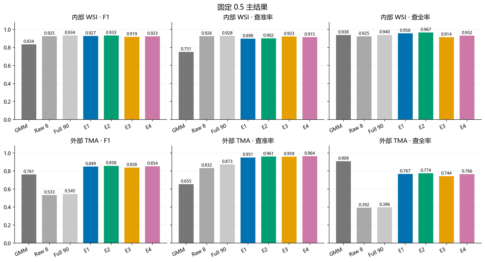
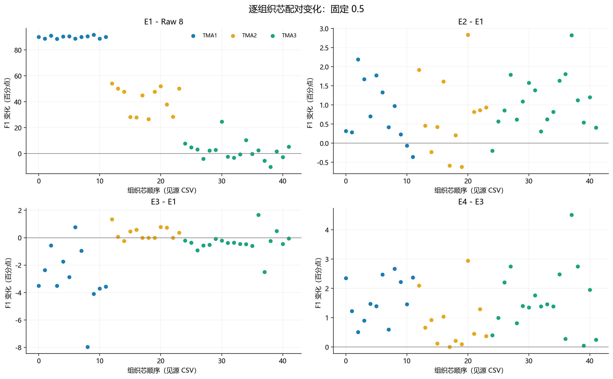
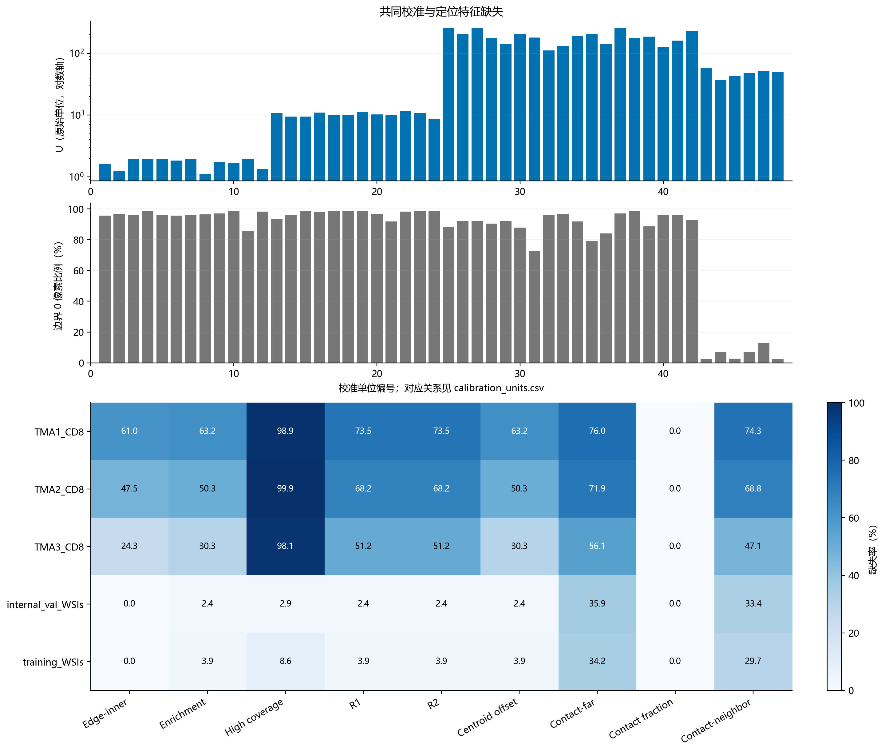
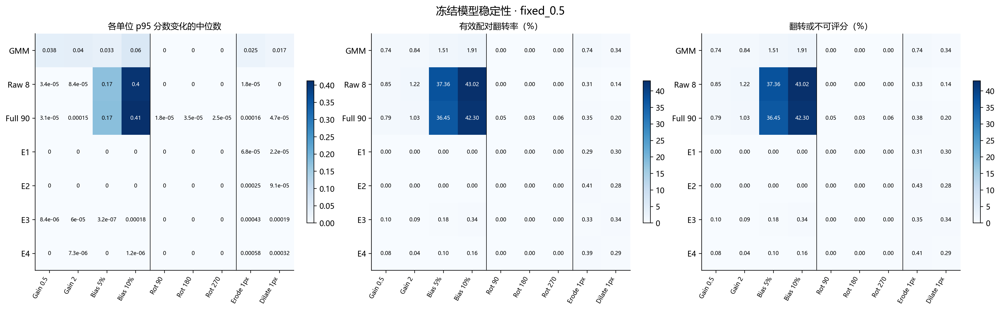
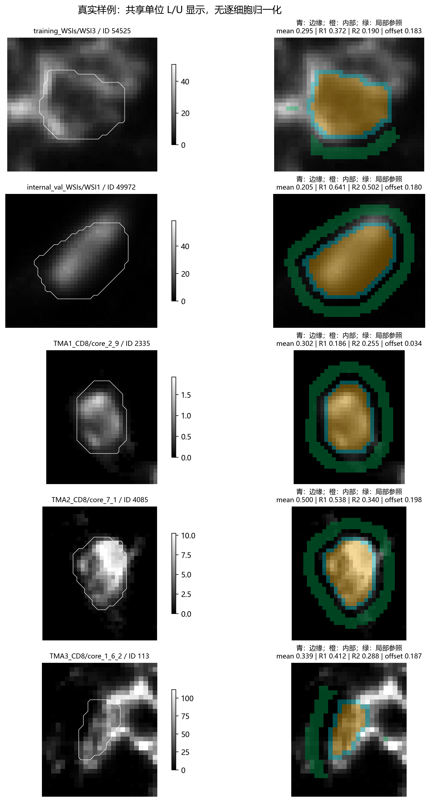

# PhenoBIC CD8：E1–E4 与冻结模型稳定性分析报告

## 结论

本轮已完成全量共同校准、像素重提取、四组固定 HGB 的 OOF/最终训练、完整验证集合评价和规定的稳定性检查。旧实验直接复用保存模型与结果；Pan-M Gold 继续封存，没有读取其图像、标签、分布或预测。

1. **共同校准明显改善外部跨图像识别。** 固定 0.5 时，原 8 项强度模型外部 F1 为 0.5333，E1 为 0.8490；内部从 0.9255 变为 0.9268，改善主要发生在外部数据。证据：[metrics_split.csv](results/metrics_split.csv)，筛选 `threshold_mode=fixed_0.5; model∈{intensity_8,E1}; split∈{internal_val_WSIs,external_val_TMA_cores}`，列 `F1`。

2. **校准后的定位特征有小幅附加收益。** E2 外部 F1 为 0.8576，优于 E1 的 0.8490；内部也改善。固定主门限下，E2 是新四组中内部与外部 F1 最高者，但内部仍略低于旧 90 项模型。该结果是固定整套 S9 的收益，不能归因于其中某个指标或直接解释为污染减少。证据：同表，`model∈{E1,E2,morphospatial_90}`，列 `F1,TP,FP,FN`；精确配对见下文。

3. **本轮没有看到接入 GMM 分数后一致的额外性能优势。** E3 的外部 F1 为 0.8377，E4 为 0.8536，均未超过主门限下 E2。补充门限下 E4 外部 F1 为 0.8626，E2 为 0.8617，差距很小；E4 的外部 AUC/AP 仍低于 E2，不能据此宣称 E4 全面最优。原 GMM 是无监督基线，新模型使用训练标签，监督条件不同。证据：[metrics_split.csv](results/metrics_split.csv)，`split=external_val_TMA_cores; model∈{E2,E3,E4}; threshold_mode∈{fixed_0.5,OOF_threshold}`，列 `F1,ROC_AUC,AP`。

稳定性结论须与下列正式性能共同理解，不能把始终预测阴性的旧模型称为可靠。

## 1. 数据、冻结方案与复现

| item | value | source |
| --- | --- | --- |
| all_cells | 1817783 | keys/key_manifest.csv; population=all; sum(rows) |
| labelled_training | 101057 | keys/key_manifest.csv; split=training_WSIs; population=labelled |
| labelled_internal | 539132 | keys/key_manifest.csv; split=internal_val_WSIs; population=labelled |
| labelled_external | 437480 | keys/key_manifest.csv; split=external_val_TMA_cores; population=labelled |
| units | 48 | calibration/calibration_parameters.csv; row count |
| sample_cells | 9600 | keys/stability_sample.csv; row count |
| new_supervised_fits | 16 | results/new_model_fit_log.csv; row count |
| stability_cell_model_pairs | 604800 | stability/STABILITY_COMPLETE.json |
| brightness_GMM_refits | 192 | stability/perturbed_calibration.csv; row count |

以上执行计数对应 [report_run_counts.csv](results/report_run_counts.csv)，列 `item,value,source`。数据 commit：`aeffd288d922ee5df4cbb414f3c1f77507ba0001`。所有关联使用 dataset_id + image_id + cell_id，无行号映射、无重新划分、无因特征缺失删行。完整目录：

`/mnt/disk3/mIHC/mif_marker_positivity_20261022/analyses/cd8_e1_e4_stability_20261023`

E1/E2/E3/E4 分别为 8/17/9/18 项；模型参数、几何参数和稳定性方案见 [E1_E4_PROTOCOL.json](E1_E4_PROTOCOL.json)、[RUN_CONFIG.json](RUN_CONFIG.json)。训练只使用原三张训练 WSI 的有标签细胞，均匀细胞权重。留一训练 WSI OOF 后在全部训练标签上拟合最终模型，无额外随机种子、超参数搜索、插补器或概率校准器。无标签实例参与本图校准，不进入监督损失和分类指标。

校准单位为每张训练 WSI、每张内部 WSI 的有效 FOV 合并区域、每个外部组织芯。原实例至少 5 有限像素即可参与 L/U，独立于结构 QC。L=min(实例 p10)，U=max(实例 p90)，所有像素共享浮点裁剪映射；8 项强度从像素重提取。内部坐标重叠按原实例/全局坐标处理，不重复计数。原始动态范围与边界比例均以合格实例内有限像素为统计集合，不包含全图未分割区域的极值。

原 GMM 来源已审计：全单位原始均值先按 0.01/99.99 百分位裁剪用于 log1p 后三成分拟合，最高两成分均值中点为 gate；映射使用未裁剪 log1p 均值及最近观测门限的分段 MinMaxScaler。原 rescale_score 是校准分数，不称阳性概率。固定映射保留 clip=False 外推。恢复状态和原分数一致性见 [GMM_mapping_recovery.csv](audit/GMM_mapping_recovery.csv)；没有用内部/外部标签调 gate。历史正常输入复核在最新“旧实验不重跑”指示前结束，此后未重训旧监督模型。

补充门限已在查看新内部/外部指标前冻结：E1=0.42, E2=0.39, E3=0.45, E4=0.3。网格、三 WSI 等权 F1 与选中门限见 [OOF_threshold_grid.csv](results/OOF_threshold_grid.csv)，筛选 model，列 threshold/mean_WSI_F1；冻结文件见 [THRESHOLDS_FROZEN.json](THRESHOLDS_FROZEN.json)。旧三组在补充面板仍使用原 0.5。所有判阳严格大于门限。OOF 选门限后在同一 OOF 上报告的 F1 是“OOF 门限开发拟合值”，不是无偏泛化成绩；完整 OOF 指标在 [OOF_metrics.csv](results/OOF_metrics.csv)。

## 2. 完整验证集合主结果

下表对应 [report_primary_performance.csv](results/report_primary_performance.csv)，来自 metrics_split.csv 的 `threshold_mode=fixed_0.5; split!=training_WSIs`；显示列与表头同名。训练最终预测属于重代入，未混入此表。

| split | model | n_total | precision | recall | F1 | ROC_AUC | AP | TP | FP | FN | TN |
| --- | --- | --- | --- | --- | --- | --- | --- | --- | --- | --- | --- |
| external_val_TMA_cores | GMM | 437480 | 0.6547 | 0.9086 | 0.7610 | 0.9903 | 0.8302 | 20290 | 10703 | 2041 | 404446 |
| external_val_TMA_cores | intensity_8 | 437480 | 0.8324 | 0.3923 | 0.5333 | 0.8137 | 0.5476 | 8760 | 1764 | 13571 | 413385 |
| external_val_TMA_cores | morphospatial_90 | 437480 | 0.8734 | 0.3964 | 0.5453 | 0.8145 | 0.6134 | 8852 | 1283 | 13479 | 413866 |
| external_val_TMA_cores | E1 | 437480 | 0.9505 | 0.7671 | 0.8490 | 0.9963 | 0.9487 | 17131 | 892 | 5200 | 414257 |
| external_val_TMA_cores | E2 | 437480 | 0.9608 | 0.7744 | 0.8576 | 0.9959 | 0.9584 | 17293 | 706 | 5038 | 414443 |
| external_val_TMA_cores | E3 | 437480 | 0.9588 | 0.7438 | 0.8377 | 0.9927 | 0.9400 | 16610 | 713 | 5721 | 414436 |
| external_val_TMA_cores | E4 | 437480 | 0.9643 | 0.7657 | 0.8536 | 0.9898 | 0.9493 | 17099 | 633 | 5232 | 414516 |
| internal_val_WSIs | GMM | 539132 | 0.7513 | 0.9382 | 0.8344 | 0.9974 | 0.9481 | 17789 | 5890 | 1171 | 514282 |
| internal_val_WSIs | intensity_8 | 539132 | 0.9264 | 0.9245 | 0.9255 | 0.9987 | 0.9783 | 17529 | 1392 | 1431 | 518780 |
| internal_val_WSIs | morphospatial_90 | 539132 | 0.9284 | 0.9397 | 0.9340 | 0.9990 | 0.9827 | 17816 | 1373 | 1144 | 518799 |
| internal_val_WSIs | E1 | 539132 | 0.8976 | 0.9579 | 0.9268 | 0.9992 | 0.9841 | 18162 | 2071 | 798 | 518101 |
| internal_val_WSIs | E2 | 539132 | 0.9018 | 0.9673 | 0.9334 | 0.9994 | 0.9878 | 18340 | 1998 | 620 | 518174 |
| internal_val_WSIs | E3 | 539132 | 0.9228 | 0.9143 | 0.9185 | 0.9988 | 0.9762 | 17336 | 1451 | 1624 | 518721 |
| internal_val_WSIs | E4 | 539132 | 0.9151 | 0.9318 | 0.9234 | 0.9991 | 0.9822 | 17666 | 1638 | 1294 | 518534 |

## 3. 配对收益与 TMA 差异

下表同时报告 TP/FP/FN 变化。正的 FP_delta 是新增误报，负的 FN_delta 是减少漏检；F1 提升不自动等同于污染减少。对应 [report_primary_paired_changes.csv](results/report_primary_paired_changes.csv)，原表 paired_changes.csv 筛选 `level=split; threshold_mode=fixed_0.5; split!=training_WSIs`，列与表头同名。

| split | comparison | F1_delta | TP_delta | FP_delta | FN_delta | ROC_AUC_delta | AP_delta |
| --- | --- | --- | --- | --- | --- | --- | --- |
| external_val_TMA_cores | E1 - intensity_8 | 0.3158 | 8371 | -872 | -8371 | 0.1825 | 0.4011 |
| external_val_TMA_cores | E2 - E1 | 0.0085 | 162 | -186 | -162 | -0.0003 | 0.0096 |
| external_val_TMA_cores | E3 - E1 | -0.0113 | -521 | -179 | 521 | -0.0036 | -0.0088 |
| external_val_TMA_cores | E4 - E3 | 0.0159 | 489 | -80 | -489 | -0.0029 | 0.0093 |
| external_val_TMA_cores | E4 - E2 | -0.0040 | -194 | -73 | 194 | -0.0062 | -0.0091 |
| external_val_TMA_cores | E4 - GMM | 0.0926 | -3191 | -10070 | 3191 | -0.0005 | 0.1191 |
| external_val_TMA_cores | E4 - morphospatial_90 | 0.3083 | 8247 | -650 | -8247 | 0.1753 | 0.3359 |
| internal_val_WSIs | E1 - intensity_8 | 0.0013 | 633 | 679 | -633 | 0.0005 | 0.0057 |
| internal_val_WSIs | E2 - E1 | 0.0066 | 178 | -73 | -178 | 0.0002 | 0.0037 |
| internal_val_WSIs | E3 - E1 | -0.0083 | -826 | -620 | 826 | -0.0004 | -0.0078 |
| internal_val_WSIs | E4 - E3 | 0.0048 | 330 | 187 | -330 | 0.0003 | 0.0060 |
| internal_val_WSIs | E4 - E2 | -0.0100 | -674 | -360 | 674 | -0.0003 | -0.0055 |
| internal_val_WSIs | E4 - GMM | 0.0890 | -123 | -4252 | 123 | 0.0017 | 0.0342 |
| internal_val_WSIs | E4 - morphospatial_90 | -0.0106 | -150 | 265 | 150 | 0.0001 | -0.0004 |

### TMA1_CD8

对应 [metrics_context.csv](results/metrics_context.csv)，筛选 `context=TMA1_CD8; threshold_mode=fixed_0.5`，列如下。

| model | precision | recall | F1 | ROC_AUC | AP | TP | FP | FN |
| --- | --- | --- | --- | --- | --- | --- | --- | --- |
| GMM | 0.8975 | 0.8135 | 0.8534 | 0.9968 | 0.9399 | 5919 | 676 | 1357 |
| intensity_8 | 0.0000 | 0.0000 | 0.0000 | 0.5291 | 0.1034 | 0 | 0 | 7276 |
| morphospatial_90 | 0.0000 | 0.0000 | 0.0000 | 0.5206 | 0.2817 | 0 | 0 | 7276 |
| E1 | 0.9433 | 0.8528 | 0.8958 | 0.9981 | 0.9626 | 6205 | 373 | 1071 |
| E2 | 0.9563 | 0.8510 | 0.9006 | 0.9985 | 0.9726 | 6192 | 283 | 1084 |
| E3 | 0.9595 | 0.7883 | 0.8656 | 0.9954 | 0.9537 | 5736 | 242 | 1540 |
| E4 | 0.9688 | 0.8079 | 0.8811 | 0.9932 | 0.9643 | 5878 | 189 | 1398 |

### TMA2_CD8

对应 [metrics_context.csv](results/metrics_context.csv)，筛选 `context=TMA2_CD8; threshold_mode=fixed_0.5`，列如下。

| model | precision | recall | F1 | ROC_AUC | AP | TP | FP | FN |
| --- | --- | --- | --- | --- | --- | --- | --- | --- |
| GMM | 0.7416 | 0.9084 | 0.8166 | 0.9951 | 0.8935 | 6238 | 2173 | 629 |
| intensity_8 | 0.9917 | 0.1395 | 0.2446 | 0.9344 | 0.8348 | 958 | 8 | 5909 |
| morphospatial_90 | 0.9937 | 0.1615 | 0.2778 | 0.9338 | 0.8640 | 1109 | 7 | 5758 |
| E1 | 0.9705 | 0.5563 | 0.7072 | 0.9948 | 0.9343 | 3820 | 116 | 3047 |
| E2 | 0.9744 | 0.5717 | 0.7206 | 0.9929 | 0.9422 | 3926 | 103 | 2941 |
| E3 | 0.9709 | 0.5628 | 0.7126 | 0.9867 | 0.9236 | 3865 | 116 | 3002 |
| E4 | 0.9739 | 0.5805 | 0.7274 | 0.9784 | 0.9319 | 3986 | 107 | 2881 |

### TMA3_CD8

对应 [metrics_context.csv](results/metrics_context.csv)，筛选 `context=TMA3_CD8; threshold_mode=fixed_0.5`，列如下。

| model | precision | recall | F1 | ROC_AUC | AP | TP | FP | FN |
| --- | --- | --- | --- | --- | --- | --- | --- | --- |
| GMM | 0.5087 | 0.9933 | 0.6728 | 0.9946 | 0.9232 | 8133 | 7854 | 55 |
| intensity_8 | 0.8163 | 0.9529 | 0.8793 | 0.9964 | 0.9294 | 7802 | 1756 | 386 |
| morphospatial_90 | 0.8585 | 0.9457 | 0.9000 | 0.9976 | 0.9626 | 7743 | 1276 | 445 |
| E1 | 0.9463 | 0.8679 | 0.9054 | 0.9975 | 0.9664 | 7106 | 403 | 1082 |
| E2 | 0.9573 | 0.8763 | 0.9150 | 0.9976 | 0.9755 | 7175 | 320 | 1013 |
| E3 | 0.9518 | 0.8560 | 0.9014 | 0.9979 | 0.9655 | 7009 | 355 | 1179 |
| E4 | 0.9555 | 0.8836 | 0.9181 | 0.9984 | 0.9759 | 7235 | 337 | 953 |

**TMA1：** 共同校准恢复了旧 8/90 项模型几乎失效的判阳与排序能力。应同时查看 ROC_AUC 和 AP，不能只看召回恢复。E2 相较 E1 的误报减少伴随少量漏检增加，并非所有方向均改善。

**TMA2：** 新模型召回显著高于旧强度模型，但仍低于原 GMM；新模型查准率较高。这是本轮仍需保留的跨域召回问题，不据外部结果改门限或改背景方案。

**TMA3：** E1–E4 相较旧 8 项模型显著减少误报，但漏检增加；与原 GMM 相比，同样是误报与漏检的权衡。上述三点的精确数字均在刚列出的 metrics_context.csv 各自筛选行及 TP/FP/FN、precision/recall、ROC_AUC/AP 列。

逐芯配对值见 [paired_changes.csv](results/paired_changes.csv)，`level=unit; split=external_val_TMA_cores; threshold_mode=fixed_0.5`；图中每个点是一枚组织芯，不假定其为独立患者。内部逐 WSI 与所有芯完整指标见 [metrics_unit.csv](results/metrics_unit.csv)。

### 单位等权表现与低表现单位

下表对应 [metrics_macro_units.csv](results/metrics_macro_units.csv)，筛选 `threshold_mode=fixed_0.5; split!=training_WSIs`。平均/标准差/最小值按 WSI 或组织芯等权，不能用细胞汇总 F1 替代。

| split | model | n_units | F1_mean | F1_std | F1_min | F1_median | units_no_positive_prediction |
| --- | --- | --- | --- | --- | --- | --- | --- |
| external_val_TMA_cores | E1 | 42 | 0.8691 | 0.0870 | 0.6032 | 0.8995 | 0 |
| external_val_TMA_cores | E2 | 42 | 0.8779 | 0.0863 | 0.6305 | 0.9097 | 0 |
| external_val_TMA_cores | E3 | 42 | 0.8605 | 0.0836 | 0.6110 | 0.8898 | 0 |
| external_val_TMA_cores | E4 | 42 | 0.8743 | 0.0830 | 0.6397 | 0.8998 | 0 |
| external_val_TMA_cores | GMM | 42 | 0.7667 | 0.1029 | 0.5055 | 0.8064 | 0 |
| external_val_TMA_cores | intensity_8 | 42 | 0.4854 | 0.3999 | 0.0000 | 0.5944 | 12 |
| external_val_TMA_cores | morphospatial_90 | 42 | 0.5027 | 0.4039 | 0.0000 | 0.6340 | 12 |
| internal_val_WSIs | E1 | 3 | 0.9159 | 0.0207 | 0.8990 | 0.9096 | 0 |
| internal_val_WSIs | E2 | 3 | 0.9224 | 0.0269 | 0.9004 | 0.9143 | 0 |
| internal_val_WSIs | E3 | 3 | 0.9247 | 0.0193 | 0.9079 | 0.9203 | 0 |
| internal_val_WSIs | E4 | 3 | 0.9245 | 0.0232 | 0.8981 | 0.9340 | 0 |
| internal_val_WSIs | GMM | 3 | 0.8170 | 0.0644 | 0.7555 | 0.8115 | 0 |
| internal_val_WSIs | intensity_8 | 3 | 0.9050 | 0.0449 | 0.8537 | 0.9242 | 0 |
| internal_val_WSIs | morphospatial_90 | 3 | 0.9184 | 0.0304 | 0.8869 | 0.9208 | 0 |

完整低表现单位在 [lowest_units.csv](results/lowest_units.csv)，按 model/split/threshold_mode 筛选后查看 image_id、F1、recall、FP、FN。未做细胞级显著性检验、细胞 bootstrap 或仅凭三张 WSI 强行估计稳定置信区间。

## 4. 补充门限结果

对应 [report_supplementary_performance.csv](results/report_supplementary_performance.csv)，来源 metrics_split.csv 的 `threshold_mode=OOF_threshold; model∈{E1,E2,E3,E4}; split!=training_WSIs`。降低门限可改变查全/查准权衡，但不改变同一模型的 AUC/AP。

| split | model | threshold | precision | recall | F1 | TP | FP | FN |
| --- | --- | --- | --- | --- | --- | --- | --- | --- |
| external_val_TMA_cores | E1 | 0.4200 | 0.9476 | 0.7730 | 0.8514 | 17261 | 954 | 5070 |
| external_val_TMA_cores | E2 | 0.3900 | 0.9564 | 0.7840 | 0.8617 | 17508 | 799 | 4823 |
| external_val_TMA_cores | E3 | 0.4500 | 0.9568 | 0.7513 | 0.8417 | 16778 | 758 | 5553 |
| external_val_TMA_cores | E4 | 0.3000 | 0.9558 | 0.7859 | 0.8626 | 17551 | 811 | 4780 |
| internal_val_WSIs | E1 | 0.4200 | 0.8725 | 0.9655 | 0.9166 | 18306 | 2676 | 654 |
| internal_val_WSIs | E2 | 0.3900 | 0.8806 | 0.9744 | 0.9251 | 18474 | 2505 | 486 |
| internal_val_WSIs | E3 | 0.4500 | 0.9140 | 0.9179 | 0.9159 | 17403 | 1637 | 1557 |
| internal_val_WSIs | E4 | 0.3000 | 0.8853 | 0.9515 | 0.9172 | 18041 | 2337 | 919 |

内部 F1 并未因 OOF 选定门限而普遍提高，外部改善也不能用于反向挑选本轮方案。两套结果都保留，未把补充结果替代主结果。

## 5. 校准、缺失与可解释性边界

所有单位的 L/U、贡献实例、动态范围、有效实例/像素数及裁剪比例见 [calibration_parameters.csv](calibration/calibration_parameters.csv)。boundary 比例以合格原实例内部的有限像素为一致集合，每个全局像素只统计一次；严格 <L/>U 裁剪与 ≤L/≥U 边界比例分别保存。极亮实例主导 U 的程度见 U_to_cell_p90_p99、second_largest_cell_p90，以及 [upper_bound_diagnostics.csv](calibration/upper_bound_diagnostics.csv)。这是一项敏感性诊断，本轮未据此更换边界。

校准摘要对应 [report_calibration_summary.csv](results/report_calibration_summary.csv)，由上表所有单位聚合，列名指明聚合方式。

| units | invalid_units | U_min | U_max | U_to_p90p99_median | U_to_p90p99_max | zero_boundary_fraction_median | upper_clip_fraction_max |
| --- | --- | --- | --- | --- | --- | --- | --- |
| 48 | 0 | 1.1261 | 255.0000 | 2.6753 | 59.3333 | 0.9584 | 0.0004 |

外部局部高信号覆盖率大量缺失，且缺失模式与真实类别相关。MAD 数值零、无校正信号、参照不足分别保留，不能把 NaN 当 0 或阴性。模型可能利用缺失模式；本轮没有加入未经消融的背景回退，因此不能把定位收益全部解释成形态生物学改善。

下表对应 [report_external_missingness.csv](results/report_external_missingness.csv)，原表 feature_availability.csv 筛选 `level=true_class; context=TMA1/2/3_CD8; class_stratum=negative/positive; feature=表中三项`，列 n/missing_rate。所有 17 项、无标签层和每单位统计仍保留在原表，QC 原因见 [QC_reasons.csv](results/QC_reasons.csv)。

| context | class_stratum | feature | n | missing_rate |
| --- | --- | --- | --- | --- |
| TMA1_CD8 | negative | edge_signal_enrichment | 138425 | 0.6631 |
| TMA1_CD8 | negative | high_signal_edge_coverage | 138425 | 0.9952 |
| TMA1_CD8 | negative | angular_R1 | 138425 | 0.7710 |
| TMA1_CD8 | positive | edge_signal_enrichment | 7276 | 0.0470 |
| TMA1_CD8 | positive | high_signal_edge_coverage | 7276 | 0.8703 |
| TMA1_CD8 | positive | angular_R1 | 7276 | 0.0488 |
| TMA2_CD8 | negative | edge_signal_enrichment | 151512 | 0.5235 |
| TMA2_CD8 | negative | high_signal_edge_coverage | 151512 | 0.9994 |
| TMA2_CD8 | negative | angular_R1 | 151512 | 0.7105 |
| TMA2_CD8 | positive | edge_signal_enrichment | 6867 | 0.0533 |
| TMA2_CD8 | positive | high_signal_edge_coverage | 6867 | 0.9843 |
| TMA2_CD8 | positive | angular_R1 | 6867 | 0.0549 |
| TMA3_CD8 | negative | edge_signal_enrichment | 125212 | 0.3187 |
| TMA3_CD8 | negative | high_signal_edge_coverage | 125212 | 0.9902 |
| TMA3_CD8 | negative | angular_R1 | 125212 | 0.5417 |
| TMA3_CD8 | positive | edge_signal_enrichment | 8188 | 0.0612 |
| TMA3_CD8 | positive | high_signal_edge_coverage | 8188 | 0.8343 |
| TMA3_CD8 | positive | angular_R1 | 8188 | 0.0618 |

expanded_nucleus 的边缘只能称为近似细胞边缘，inner 不是已验证的细胞核；无独立组织 mask，局部环带只是周细胞参照。无像素尺寸，不能声称跨图像已统一物理尺度。详细定义及 NaN 条件见 [FEATURE_DICTIONARY.md](FEATURE_DICTIONARY.md) 与 [FEATURE_DICTIONARY.csv](FEATURE_DICTIONARY.csv)。

## 6. 冻结模型稳定性

固定 seed=0，按每单位有原标签的 ID 均匀抽取，最多 200 个；清单在 stability_sample.csv（完整抽样键表保留服务器：`keys/stability_sample.csv`，未纳入 Git），不是按正确性/置信度选样。所有七模型使用相同细胞。稳定性是抽样性能，不能替代正式完整验证集指标。

增益/偏置：正增益与共同偏置下 L/U 和所有细胞原始均值使用数学等价加速，已经在代表完整单位逐像素核验；完整单位 GMM 重新拟合，不用 200 个样本分布代替。原始强度/90 项模型从扰动像素重提取。旋转共同变换图像、所有邻居 ID、valid 支持，核验强度不变后复用 GMM。完整原图及内部 FOV 合并画布旋转后再裁剪的等价性检查见 [full_field_rotation_checks.csv](tests/full_field_rotation_checks.csv)，all_context_pixels_identical 列全部通过。mask 腐蚀/膨胀 1 px，膨胀仅入原背景、等距竞争留背景，所有邻居同规则；冻结 L/U 和原 GMM 映射，新均值重新评分。halo=8 px，缺失图像支持标 invalid。

输入有效性和数值输出分开判断。mask 消失、像素不足、必要校准失败即不可评分；S 局部缺失但必要强度有效时继续 HGB 评分。主翻转率分母为两侧均有效固定配对；“翻转或不可评分比例”分母是原抽样总数。每单位完整分子/分母、双向翻转、阳性比例变化、前后 precision/recall/F1 见 [stability_unit.csv](stability/stability_unit.csv)；按 split/context 见同目录对应 CSV。

下表仅汇总外部抽样的固定 0.5。affine/rotation 的 max 为各自预定扰动行的最大值，不是额外搜索；mask 两项单独列出。对应 [report_stability_overview.csv](results/report_stability_overview.csv)，筛选 `threshold_mode=fixed_0.5`；来源 stability_split.csv 的 `split=external_val_TMA_cores`。变化与比例均为原始数值，0.01 即 1%。

| model | affine_max_flip_rate | affine_max_score_change_p95 | rotation_max_flip_rate | erosion_flip_rate | dilation_flip_rate | erosion_flip_or_unscoreable_rate | dilation_flip_or_unscoreable_rate | erosion_coverage | dilation_coverage |
| --- | --- | --- | --- | --- | --- | --- | --- | --- | --- |
| GMM | 0.0186 | 0.1417 | 0.0000 | 0.0071 | 0.0031 | 0.0071 | 0.0031 | 1.0000 | 1.0000 |
| intensity_8 | 0.4015 | 0.7928 | 0.0000 | 0.0025 | 0.0008 | 0.0027 | 0.0008 | 0.9998 | 1.0000 |
| morphospatial_90 | 0.3926 | 0.8393 | 0.0002 | 0.0024 | 0.0011 | 0.0026 | 0.0011 | 0.9998 | 1.0000 |
| E1 | 0.0000 | 0.0000 | 0.0000 | 0.0025 | 0.0029 | 0.0027 | 0.0029 | 0.9998 | 1.0000 |
| E2 | 0.0000 | 0.0000 | 0.0000 | 0.0027 | 0.0023 | 0.0030 | 0.0023 | 0.9998 | 1.0000 |
| E3 | 0.0012 | 0.0009 | 0.0000 | 0.0029 | 0.0032 | 0.0031 | 0.0032 | 0.9998 | 1.0000 |
| E4 | 0.0007 | 0.0003 | 0.0000 | 0.0031 | 0.0025 | 0.0033 | 0.0025 | 0.9998 | 1.0000 |

图中分数变化为各单位 p95 的中位数；翻转率按有效配对计数汇总，不能与单个 split 的 p95 混为一谈。完整绘图聚合见 [stability_plot_data.csv](figures/source_data/stability_plot_data.csv)。补充门限的同类表和图均保留。mask 前后配对 F1、precision、recall 见 stability_split.csv；不能因为翻转少就忽视原始召回不足。

**实际稳定性发现：** E1/E2 在全部抽样细胞的四种亮度扰动和三种旋转中，固定 0.5 均无判阳翻转；接入 GMM 分数的 E3/E4 在亮度扰动下出现少量变化。与此相比，旧原始强度模型对共同偏置敏感。mask 的 1 px 变化仍导致少量翻转，腐蚀还使部分 HGB 输入无效；这些失效已经计入原抽样总分母，不能默认为阴性或忽略。具体失效为腐蚀后实例变为不连通，而非像素消失：详见 [input_invalid_cases.csv](stability/input_invalid_cases.csv)，筛选 perturbation=erode_1，查看 image_id、cell_id、observed_pixels、qc_reasons。证据：[report_stability_all_samples.csv](results/report_stability_all_samples.csv)，筛选 threshold_mode=fixed_0.5 与相应 model/perturbation，查看 flip_count、unscoreable、valid_pairs、flip_rate、flip_or_unscoreable_rate。分数稳定性并不弥补 TMA2 原有召回不足。

方向特征的数值核验见 [report_rotation_feature_checks.csv](results/report_rotation_feature_checks.csv)，由 feature_invariance.csv 筛选 rotate_* 后按 feature 取最大值。正常输入评分重现见 [original_score_reproduction.csv](stability/original_score_reproduction.csv)；每个 model/image_id 的 max_original_score_reproduction_error 用于确认上下文和特征顺序未偏离原流程。

## 7. 真实示例与交付检查

样例来自预定样本中的代表训练/内部/TMA1/2/3 单位，选择有有效 R1 且归一化均值较高的实例；不按标签或预测正确性选择。原始图像与归一化显示都使用各单位共同 L/U，没有逐细胞 min–max。ID、文件、关键特征与选样规则见 [example_index.csv](examples/example_index.csv)。这些图用于检查空间属性与数值对应，不是人工重标注或性能证据。

受控图像测试和固定真实样例检查见 tests/CONTROLLED_TESTS_PASSED.json、tests/real_pilot_checks.csv；完整单位像素扰动检查见 tests/full_unit_affine_equivalence.csv。目视核对的五个真实实例及解释见 examples/VISUAL_REVIEW.csv；未将这些例子当作人工专家复核标签。代码、运行配置、模型、键清单、完整逐细胞 Parquet、完整 ROC/PR/threshold 数组已保留服务器。审阅包的 README 明确各全量文件相对位置；结合本报告开头服务器根目录即可定位；[FULL_ARTIFACT_PATHS.csv](FULL_ARTIFACT_PATHS.csv) 还给出全量特征、OOF/最终预测、模型、曲线及 GMM 状态的实际绝对路径、大小、行数和 SHA256。交付 OOF 使用带 with_QC 后缀的表，原 OOF 亦保留。推理 API 的一致性与异常输入测试见 [API_INTERFACE_CHECKS.csv](tests/API_INTERFACE_CHECKS.csv)。图件同时提供 PNG、文字可编辑 SVG 和源 CSV。最终一致性核验见 [FINAL_VALIDATION_CHECKS.csv](results/FINAL_VALIDATION_CHECKS.csv)，包括原始文件 SHA256 未变化、键完整性、16 次新拟合、严格门限、完整扰动覆盖和方向不变性。

下一轮最值得检验的是 TMA2 的召回不足及局部参照在 TMA 的退化问题，但本轮没有据验证成绩改变任何冻结流程。当前证据支持共同校准和固定定位特征的价值，不支持预设 E4 最优，也不足以把改善归因于真实膜定位或污染识别。

参考实现：[PhenoBIC 官方仓库](https://github.com/Shachi-Mittal-Lab/PhenoBIC-qupath-extension)；[SCIMAP rescale 文档](https://scimap.xyz/Functions/pp/rescale/)。本轮以用户指定准确公式、原项目冻结源码和实际保存状态为执行依据。

全部表格及字段索引：[TABLE_INDEX.csv](TABLE_INDEX.csv)；关键结论数值索引：[NUMERIC_CLAIMS_INDEX.csv](results/NUMERIC_CLAIMS_INDEX.csv)。
