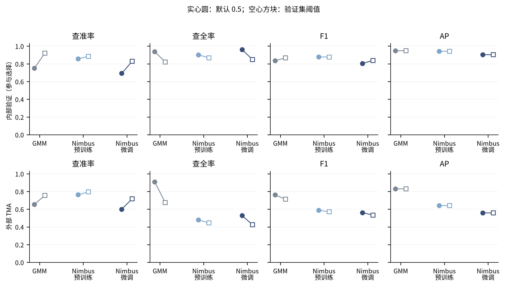
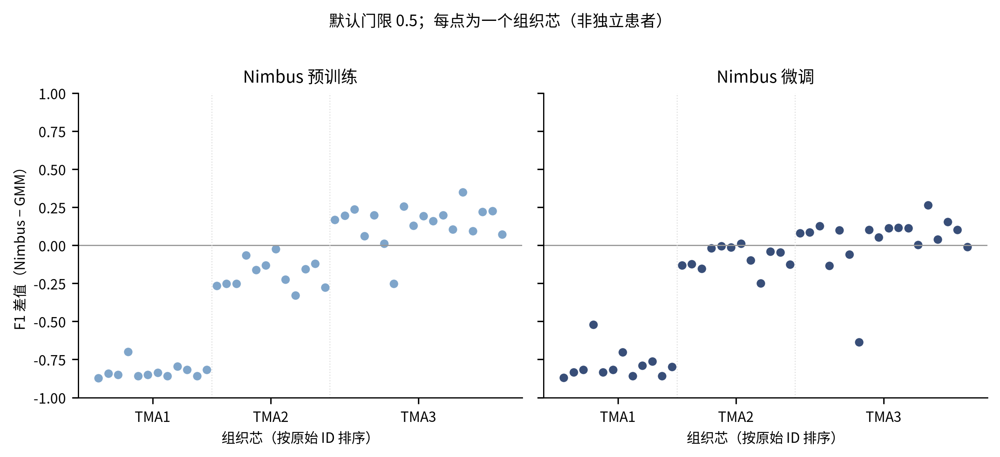
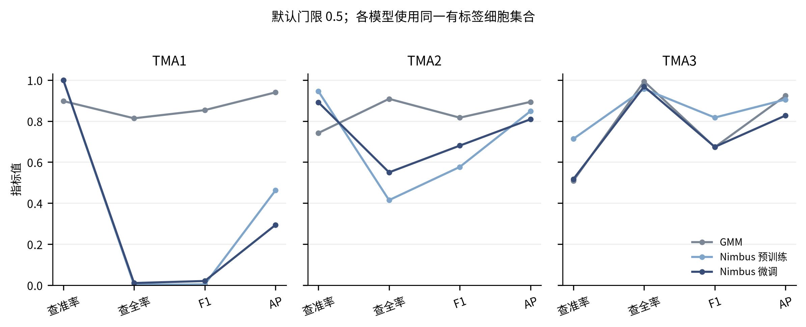

# Nimbus：PhenoBIC CD8 研究性复现与任务适配

## 结论与表格定位

本轮实际完成官方固定预训练权重推理、PhenoBIC 训练 WSI 微调及全量逐细胞评价。原 GMM 直接复用已保存的连续分数；未重新拟合。结果不代表重现论文整套数据或论文报告指标。

- **Nimbus_pretrained**：外部 TMA 默认门限 F1=0.5885，相对原 GMM 变化 -0.1725；precision=0.7634、recall=0.4788、AP=0.6400。TP/FP/FN 分别变化 -9597/-7389/+9597。
- **Nimbus_finetuned**：外部 TMA 默认门限 F1=0.5611，相对原 GMM 变化 -0.1999；precision=0.5993、recall=0.5275、AP=0.5579。TP/FP/FN 分别变化 -8510/-2827/+8510。

固定 0.5 时，本轮外部集合 F1 最高的是 GMM（0.7610）；各模型使用其验证集冻结门限时，最高的是 GMM（0.7126）。微调相对直接预训练的默认门限 F1 变化为 -0.0274，AP 变化为 -0.0821，FP/FN 变化为 +4562/-1087。这些是冻结设定下的配对描述结果，不作为显著性或普遍优越性的证明。

上述数字来自 [results/overall_metrics.csv](results/overall_metrics.csv)，筛选 `split=external_val_TMA_cores, threshold_mode=official_default`；列为 `F1, precision, recall, AP, TP, FP, FN`。差值同时见 [results/paired_vs_GMM.csv](results/paired_vs_GMM.csv)，筛选 `level=split, split=external_val_TMA_cores, threshold_mode=official_default`，列 `delta_*`。F1 变化同时受漏检与误报影响，不能据此确认污染减少。

## 完成范围与分组

| split | n_cells | n_labelled | key_sha256 |
| --- | --- | --- | --- |
| external_val_TMA_cores | 438236 | 437480 | e29e87086b00f9647390366fc1a12aa82be5a230d224d0327338ae1071fee85b |
| internal_val_WSIs | 667125 | 539132 | b19a9b4cf267e82c6ceb9dfcaa6c4c8617ffa1e7c46fcc250e4c03d96599db30 |
| training_WSIs | 712422 | 101057 | 45d966f5ba6de3c121d903803dd5fb897be560fc7540f8b62004e70e2255f6c6 |

计数和键哈希来自 [provenance/key_counts_hashes.csv](provenance/key_counts_hashes.csv)。完整四键 `dataset_id,image_id,cell_id,marker` 见 `provenance/cell_keys.parquet` 和各 split 的压缩 CSV。原始数据、实例 ID 和旧结果保留，所有细胞都保留预测行。正式分类指标及阳性比例误差均在原有标签集合上计算；未标注细胞保留预测，不当作阴性。

- 训练：官方三张训练 WSI；有标签细胞用于监督，未标注实例以官方 activity=2 忽略。
- 内部验证：官方三张内部 WSI，用于微调检查点与补充门限选择。其成绩属于参与选择后的开发成绩。
- 外部测试：官方 CD8 TMA 组织芯；模型、预处理与门限冻结后评价。
- 缺少可核实的患者映射，按原 WSI/TMA 切片分组；组织芯不是独立患者。内部数据说明指出来自其他患者，但未提供可审计患者编号。
- 内部／外部 PhenoBIC 在先前 GMM/E1–E4 中已被查看，本轮不将它们描述为从未接触的前瞻性测试队列。
- Pan-M 全部封存。本轮未读取其图像、标签、分布或预测，未下载完整 Pan-M。

## 版本与官方预处理

官方推理／微调仓库 commit：`241281ef85ba34d9857cc03886cc45aedd0f0b34`；原训练仓库 commit：`6942b10cc106654c154bc057af36bcf0f0b3604d`。
权重 `V1.pt`，下载 revision `3affc9e774d68408701e44ed6136b1e13503c639`，SHA-256 `0651a3852fbafc03be415a1ec80ef947cc1913a081cf0bc649301ade887a82a9`，经公开镜像下载并与 HF LFS 哈希核对。固定本地文件加载，未调用 latest。

官方代码从每幅图像 **I>0 的像素**计算 99.9% 分位数，然后按 marker 求图像间均值。本项目只用训练三张 WSI 拟合该系数，满足训练期拟合边界；系数为 **17.2643260511**。见 [results/normalization_parameters.csv](results/normalization_parameters.csv) 的 `value` 列及 `models/normalization.json`。所有图像共用这一冻结 CD8 系数。分图原始动态范围和截断比例见 `results/preparation.csv`；按 WSI/TMA 汇总见 `results/input_scale_summary.csv`，筛选 `split/context`，列 `raw_min,raw_max,fraction_clipped_to_one`。截断比例的分母为该图全部有限有效像素（含背景），分子为原始强度严格大于冻结系数的像素；不能将它误读为阳性细胞比例。

外部来源的输入尺度诊断：

| context | raw_max | normalization_factor | normalized_global_max_after_clip | fraction_clipped_to_one |
| --- | --- | --- | --- | --- |
| TMA1_CD8 | 2.013932 | 17.264326 | 0.116653 | 0.000000 |
| TMA2_CD8 | 14.645147 | 17.264326 | 0.848290 | 0.000000 |
| TMA3_CD8 | 255.000000 | 17.264326 | 1.000000 | 0.011578 |

来源：[results/input_scale_summary.csv](results/input_scale_summary.csv)，筛选 `split=external_val_TMA_cores`，列见表头。这些是输入图像数值，不是模型评分或细胞阳性门限。TMA1 的原始范围较训练 WSI 小；共享训练系数会将其输入压缩到较低范围。本轮能确认这种尺度差异与性能差异同时存在，不能据此单独确定归一化、像素尺度和模型域偏移各自的贡献；没有根据测试成绩改换预处理。

输入图像转 float32、除以该系数、截断到 [0,1]。作者示例传入 clip_values=(0,2)，但固定源码的实际 get_channel_normalized 截断为 [0,1]；本轮遵守实际实现。没有逐细胞 min–max，没有将 E1 校准替换进 Nimbus。

第二输入通道是 `prepare_binary_mask`：实例内边界为零，剩余实例内部为一。原始 mask 始终保留。最终评分是原实例全部像素的模型输出均值，**包含原边界**；不只是输入二值前景的平均。分数未额外做概率校准。

沿用官方默认 magnification 20、模型 magnification 10，按 0.5 缩放：强度双线性，二值 mask 最近邻，预测最近邻还原到原始尺寸。TIFF 未提供可核实的 µm/px，故这是官方默认尺度假设；不能称已完成物理尺度统一。见 [results/image_scale_metadata.csv](results/image_scale_metadata.csv)。

固定源码的 TTA 旋转闭包实际执行四次 270°，再执行上下和左右翻转。本轮保留这一行为，通过复用相同旋转输出并保持权重得到等价结果。详见 `tests/PILOT_PASSED.json` 与实际源码 `utils.py:test_time_aug`；未悄悄修成另一套增强。

来源：[论文](https://www.nature.com/articles/s41592-025-02826-9)、[固定推理源码](https://github.com/angelolab/Nimbus-Inference/tree/241281ef85ba34d9857cc03886cc45aedd0f0b34)、[官方训练仓库](https://github.com/angelolab/Nimbus/tree/6942b10cc106654c154bc057af36bcf0f0b3604d)、[固定权重](https://huggingface.co/JLrumberger/Nimbus-Inference/tree/3affc9e774d68408701e44ed6136b1e13503c639)。

I/O 执行调整：首次并行准备／推理因磁盘争用停止，当时没有完整图像预测落表；保留日志和部分缓存。随后采用 RAM 中间数组，真实像素对照再次通过后开始正式顺序执行，数值方法不变。证据为 `provenance/IO_EXECUTION_FIX.json`、`tests/ram_tta_equivalence.csv`；正式运行资源表不包含停止的尝试。

## 适配与验证

全局先拼接内部 WSI 的有效 FOV，检查重叠图像像素相等、非零 ID 无冲突，避免重复计数。模型采用官方 UNet、固定全图切块坐标与 reflection padding；只跳过不贡献任何原始实例像素的输出块。输入上下文保留全部邻居。先完成拼接预测，再按原实例聚合，因此跨模型块接缝细胞仍只有一条记录。

五类真实来源的参考对照：

| split | context | n_instances | n_ids_above_uint16 | max_abs_official_streaming_error |
| --- | --- | --- | --- | --- |
| training_WSIs | WSI1 | 3861 | 1417 | 0.000000 |
| internal_val_WSIs | WSI1 | 1471 | 0 | 0.000000 |
| external_val_TMA_cores | TMA1_CD8 | 6346 | 0 | 0.000000 |
| external_val_TMA_cores | TMA2_CD8 | 8772 | 0 | 0.000000 |
| external_val_TMA_cores | TMA3_CD8 | 7980 | 0 | 0.000000 |

来源：[tests/pilot_reference_comparison.csv](tests/pilot_reference_comparison.csv)。对照覆盖训练、内部验证、TMA1/2/3，比较同一真实像素输入下官方原始实现与内存受控适配输出。受控验证另见 [tests/controlled_contract_checks.csv](tests/controlled_contract_checks.csv)：大 ID、未标注忽略、边界聚合、最近邻坐标及全局归一化。

在预训练 TMA1 低检出率出现后，追加原始像素与全图缓存核验，共检查 20 个真实位置。归一化及实例／二值边界映射一致，全局双线性插值最大差异为 2.980e-08。来源：[tests/global_preparation_pixel_checks.csv](tests/global_preparation_pixel_checks.csv)，列 `raw_normalization_max_error,global_linear_resize_max_error,instance_nearest_exact,binary_boundary_exact`。这是实现检查，未因此修改预处理、模型、门限选择规则或数据划分。

全量缓存每个单位验证 ID 集合与冻结键一致；预测检查所有原实例像素均有有限输出、键唯一、无遗漏。原文件元数据与已核验 SHA 清单匹配；PhenoBIC 352 个 CD8 图像／mask 来源记录未发现跨官方 split 的完全相同文件。证据：[provenance/PhenoBIC_source_checksums.csv](provenance/PhenoBIC_source_checksums.csv)、[results/exact_file_overlap_between_splits.csv](results/exact_file_overlap_between_splits.csv)。文件哈希不能排除不同裁剪或不同编码的同源图像。

## 微调方法

调用固定仓库的官方 Trainer，保留 UNet、平滑 BCE、AdamW、初始权重约束、增强、调度和早停逻辑。参数见 `NIMBUS_PROTOCOL.json`：最大 10 epoch，learning_rate=3e-6，batch_size=8，patience=5，seed=0。实际运行 **8 轮**，选择第 **3 轮**权重；对应官方切块验证 F1 为 **0.760304**。来源：[results/finetuning_summary.csv](results/finetuning_summary.csv)，列 `completed_epochs,selected_epoch,checkpoint_tile_F1`。该 F1 不用于冒充后文完整实例评价。未做架构替换或超参数搜索。官方调度器实际每个 epoch 调用一次 step；本轮保留该行为，实际学习率见微调验证历史 CSV 的 learning_rate_applied 列，不能把 warmup_steps 参数名误读为本轮实际执行了逐 batch 调度。

适配层不使用官方准备脚本中的 uint16 实例转换，保持原 uint32 ID；末端 tile 使用正确的补齐尺寸。原未标注实例显式设 activity=2，背景遵循官方标签语义。仅包含至少一个人工标签像素的训练 tile 进入训练。官方 0.5 最近邻下采样后没有可用像素的有标签实例另列于 `results/finetuning_instances_without_scaled_support.csv`，仍保留在最终原图推理和评价集合。

检查点验证在每个内部 WSI 的 eligible tile 中预先以 seed=0 均匀抽取最多 128 个。其官方 tile 内部聚合 F1 只用于检查点选择；tile 跨界实例可能贡献多个片段，这不是正式全量逐细胞成绩。最终正式评价始终使用完整图像中唯一原实例 ID。训练覆盖及检查点历史见 [results/finetuning_data_coverage.csv](results/finetuning_data_coverage.csv)、[results/finetuning_validation_history.csv](results/finetuning_validation_history.csv)。

## 默认与验证门限结果

默认规则为严格 `score > 0.5`，来自官方 Trainer 判定约定。补充门限在内部验证完整有标签细胞上，以三张 WSI 等权 F1 选取 0.01–0.99 网格最大者；并列先接近 0.5，再取较高值。补充门限不重新训练模型。优化目标是 WSI 等权平均 F1，与总体细胞汇总 F1 不同，因此总体 F1 不保证随门限选择而上升；AP/ROC-AUC 不受分类门限改变。

| model | default | validation_selected | validation_development_fitted_macro_F1 |
| --- | --- | --- | --- |
| GMM | 0.500000 | 0.590000 | 0.884445 |
| Nimbus_pretrained | 0.500000 | 0.540000 | 0.868094 |
| Nimbus_finetuned | 0.500000 | 0.610000 | 0.821486 |

来源：[results/threshold_summary.csv](results/threshold_summary.csv)，列见表头。门限开发 F1 有选择偏倚，不作为无偏泛化估计。GMM 补充列只在旧连续分数上应用本轮验证门限，原默认基线保持不变。

| model | split | threshold_mode | precision | recall | F1 | ROC_AUC | AP | positive_fraction_absolute_error | coverage |
| --- | --- | --- | --- | --- | --- | --- | --- | --- | --- |
| GMM | external_val_TMA_cores | official_default | 0.654664 | 0.908602 | 0.761008 | 0.990281 | 0.830201 | 0.019800 | 1.000000 |
| GMM | internal_val_WSIs | official_default | 0.751256 | 0.938238 | 0.834400 | 0.997437 | 0.948060 | 0.008753 | 1.000000 |
| GMM | external_val_TMA_cores | validation_selected | 0.755138 | 0.674623 | 0.712613 | 0.990281 | 0.830201 | 0.005443 | 1.000000 |
| GMM | internal_val_WSIs | validation_selected | 0.920272 | 0.821255 | 0.867949 | 0.997437 | 0.948060 | 0.003784 | 1.000000 |
| Nimbus_pretrained | external_val_TMA_cores | official_default | 0.763404 | 0.478841 | 0.588530 | 0.923960 | 0.639981 | 0.019027 | 1.000000 |
| Nimbus_pretrained | internal_val_WSIs | official_default | 0.856599 | 0.902004 | 0.878715 | 0.997794 | 0.942046 | 0.001864 | 1.000000 |
| Nimbus_pretrained | external_val_TMA_cores | validation_selected | 0.795484 | 0.444852 | 0.570608 | 0.923960 | 0.639981 | 0.022499 | 1.000000 |
| Nimbus_pretrained | internal_val_WSIs | validation_selected | 0.884557 | 0.867669 | 0.876032 | 0.997794 | 0.942046 | 0.000671 | 1.000000 |
| Nimbus_finetuned | external_val_TMA_cores | official_default | 0.599308 | 0.527518 | 0.561126 | 0.878945 | 0.557878 | 0.006115 | 1.000000 |
| Nimbus_finetuned | internal_val_WSIs | official_default | 0.692337 | 0.959705 | 0.804385 | 0.996479 | 0.902812 | 0.013581 | 1.000000 |
| Nimbus_finetuned | external_val_TMA_cores | validation_selected | 0.717749 | 0.424298 | 0.533322 | 0.878945 | 0.557878 | 0.020870 | 1.000000 |
| Nimbus_finetuned | internal_val_WSIs | validation_selected | 0.828407 | 0.848418 | 0.838293 | 0.996479 | 0.902812 | 0.000850 | 1.000000 |

来源：[results/overall_metrics.csv](results/overall_metrics.csv)，筛选 `split != training_WSIs`，列见表头。TP/FP/FN/TN、真实和预测阳性比例见同一表。逐 WSI、逐 TMA、逐组织芯结果位于 [results/all_metrics.csv](results/all_metrics.csv)，分别筛选 `level=slide` 或 `level=image`。等权均值、最低 F1、无阳性预测单位数见 [results/unit_equal_weight_summary.csv](results/unit_equal_weight_summary.csv)。

单位等权汇总按该指标非 NA 的单位计算，实际分母见 n_F1_defined、n_AUC_defined、n_AP_defined 列。

无真阳性单位的 recall/AP/ROC-AUC 返回 NA；同时无真阳性且无阳性预测时 F1 为 NA。没有阳性预测但存在真阳性时 precision/F1=0。无负类单位 specificity/ROC-AUC=NA。不可评分行保留；若某个正式集合存在不可评分记录，其主分类指标返回 NA 并报告覆盖率，避免用成功子集冒充全量。

Nimbus_pretrained 继承作者在其他数据上的监督预训练；Nimbus_finetuned 额外使用 PhenoBIC 训练标签；GMM 的分数拟合及原默认门限基线是无监督的；本轮补充门限列使用了内部验证标签选择门限，不称为完全无监督的分类流程。这些监督条件不同。没有细胞级显著性检验或 bootstrap，没有将组织芯视为独立患者。

## 各 TMA 的差异

- **TMA1_CD8**：Nimbus_pretrained：F1 0.0036（Δ-0.8499），AP 0.4620（Δ-0.4779），ROC-AUC 0.8403，recall 0.0018（Δ-0.8117），FP 0（Δ-676），FN 7263（Δ+5906）；Nimbus_finetuned：F1 0.0201（Δ-0.8333），AP 0.2935（Δ-0.6464），ROC-AUC 0.7562，recall 0.0102（Δ-0.8033），FP 0（Δ-676），FN 7202（Δ+5845）。
- **TMA2_CD8**：Nimbus_pretrained：F1 0.5763（Δ-0.2403），AP 0.8485（Δ-0.0451），ROC-AUC 0.9846，recall 0.4144（Δ-0.4940），FP 163（Δ-2010），FN 4021（Δ+3392）；Nimbus_finetuned：F1 0.6803（Δ-0.1363），AP 0.8088（Δ-0.0847），ROC-AUC 0.9747，recall 0.5499（Δ-0.3585），FP 458（Δ-1715），FN 3091（Δ+2462）。
- **TMA3_CD8**：Nimbus_pretrained：F1 0.8172（Δ+0.1443），AP 0.9050（Δ-0.0182），ROC-AUC 0.9941，recall 0.9568（Δ-0.0365），FP 3151（Δ-4703），FN 354（Δ+299）；Nimbus_finetuned：F1 0.6739（Δ+0.0010），AP 0.8271（Δ-0.0961），ROC-AUC 0.9879，recall 0.9685（Δ-0.0248），FP 7418（Δ-436），FN 258（Δ+203）。

来源：[results/all_metrics.csv](results/all_metrics.csv)，筛选 `level=slide, split=external_val_TMA_cores, threshold_mode=official_default, context=TMA1_CD8/TMA2_CD8/TMA3_CD8`，列 `F1, AP, ROC_AUC, recall, FP, FN`；Δ 均为同切片、同门限模式相对 GMM 的差值，另见 `results/paired_vs_GMM.csv`。AP/ROC-AUC 描述排序可分性，召回和误报／漏检还受门限影响。

本轮的具体问题并不一致：TMA1 的两种 Nimbus 均严重漏检；TMA2 微调改善了召回与 F1，但仍低于 GMM；TMA3 预训练以增加少量漏检为代价减少误报、提高 F1，微调后误报重新增加，未保持该优势。上述判断均对应同一表中三个 context 的默认门限行，不归因为已经证实的污染抑制机制。

## 开发集错误审阅与解释边界

开发集假阳性、假阴性完整列表在 `development_review/*_all_development_errors.csv.gz`；示例索引见 [development_review/development_cases.csv](development_review/development_cases.csv)。五类为可重复筛选的图像属性候选：弱阳性、邻居接触侧亮信号、较高局部参照、边缘局部亮斑、掩码或上下文不完整。条件及可用案例数见 `case_selection_rules.json` 和 `case_availability.csv`。可见邻居的原标签、裁剪内强度均值和边界截断标记见 `development_review/visible_neighbors.csv`；该均值不是整个邻居细胞的均值。每类按固定 seed 选取，不能据候选类别直接确认污染机制或分割错误。同一示例在三种模型下的评分与两套预测见 `development_review/case_model_comparison.csv`，以 `case + 四键 + model` 查询。

NPZ 保留原始 CD8 数值、实例图、有效支持及坐标。图上橙色线为目标 **expanded_nucleus** 的边界；不是经验证的真实细胞膜。仅显示时按该 crop 有效像素的 99.5% 分位数设灰度上限，未改模型输入。每张图的显示范围、原文件及 crop 坐标均在案例 CSV；比例尺为 20 px，不使用未知物理尺寸。缺失有效支持的像素以独立灰色显示，不作为真实黑色背景。人工审阅记录见 `development_review/VISUAL_REVIEW.md` 与 `visual_review_notes.csv`。

可视审阅的具体结论见 [development_review/VISUAL_REVIEW.md](development_review/VISUAL_REVIEW.md) 与 [逐例 CSV](development_review/visual_review_notes.csv)。C00 展示弱信号漏检；C02 展示接触侧亮信号与误报共存；C14/C30 为分离掩码下的漏检；C29 仅为邻域支持截断，不能称目标本身被截断。C18、C22 展示微调新增误报。同细胞模型判断来自 `case_model_comparison.csv`，筛选相应 `case,model`。高局部参照候选未能确认典型均匀弥漫背景，不能宣称已覆盖或解决该错误类型。这些选定案例不能用于估计形态类别的错误发生率。

## 运行资源与复现

| model | fit_seconds | inference_seconds | cells | peak_gpu_allocated_gib | fit_peak_gpu_allocated_gib |
| --- | --- | --- | --- | --- | --- |
| Nimbus_finetuned | 480.750305 | 2535.961229 | 1817783 | 0.981038 | 5.836807 |
| Nimbus_pretrained | 0.000000 | 2566.031956 | 1817783 | 0.981038 | 0.000000 |

来源：[results/runtime_summary.csv](results/runtime_summary.csv)，逐图耗时见 `results/inference_runtime_by_image.csv`。硬件为同一 Quadro RTX 4000（8 GB），Python 3.11.13、PyTorch 2.2.2+cu118。正式推理耗时含本图 TTA、拼接和实例聚合，数据预处理另外见 `results/preparation.csv`。峰值 RSS 是进程观测峰值，GPU allocated/reserved 是 PyTorch 内存统计；不等于系统整体峰值。原 GMM 没有重跑，本轮不伪造它与 Nimbus 的同时测时比较。

运行配置、依赖锁定文件、代码和权重校验清单随包交付。适配代码 Git 快照见 `provenance/adapter_code_commit.json` 和 `adapter-source.bundle`；每个脚本哈希见 `adapter_code_hashes.csv`。逐模型来源、权重、门限和配置关联见 `models/*_manifest.json`、`results/model_manifest.csv`。完整 Parquet/CSV 路径见 [FULL_ARTIFACT_PATHS.csv](FULL_ARTIFACT_PATHS.csv)。
服务器根目录：`/mnt/disk3/mIHC/mif_marker_positivity_20261022/analyses/cd8_nimbus_20261024`。

复现命令见 [README.md](README.md)。每一步有独立入口；断点缓存校验原输入清单、协议、归一化、代码和模型哈希，拒绝不兼容复用。

独立接缝和唯一键核验见 [results/prediction_integrity.csv](results/prediction_integrity.csv)、[results/seam_cell_audit.csv](results/seam_cell_audit.csv)。原实例像素计数与既有清单的比较见 `results/mask_pixel_count_comparison.csv`。

## 预训练来源与未覆盖内容

作者公开资料说明 Nimbus 使用 Pan-M，并用其中人工复核 Gold-Standard 评价。因此未审计独立性前，不能把 Pan-M Gold 称为完全独立跨域验证。[作者说明](https://github.com/angelolab/Nimbus-Inference)与[论文](https://www.nature.com/articles/s41592-025-02826-9)为依据。这里只审计公开说明，没有打开封存的数据。

本轮没有完整 V1 训练图像的作者校验清单，不能完全排除预训练图像与 PhenoBIC 的同源关系；较晚公开日期不是独立性的证明。与 Pan-M 的跨数据集图像重叠检查因其封存且缺少完整 V1 训练图像清单而未执行；本轮完成的是 PhenoBIC 内部各官方划分间的完全相同文件检查。见 [results/pretraining_exposure_audit.csv](results/pretraining_exposure_audit.csv)。

论文队列的公开、封存、未获取和未核实状态逐项列于 [PAPER_DATA_SCOPE.md](PAPER_DATA_SCOPE.md)；没有证据时不把“未运行”写成“未公开”。

本轮只覆盖 PhenoBIC CD8 任务适配，未运行 Pan-M Gold 或完整 Pan-M、多 marker／细胞类型实验、论文全部外部队列及原始大规模预训练。未取得或未使用的论文数据、患者映射及物理像素尺寸不作已完成声明。
