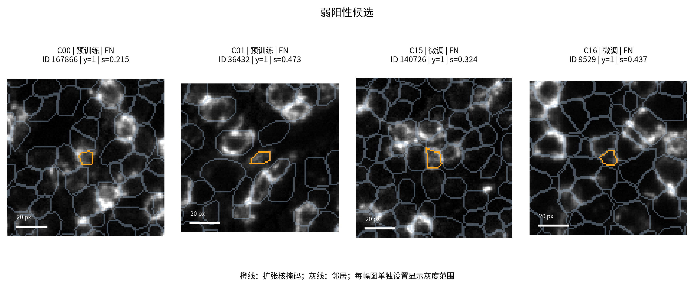
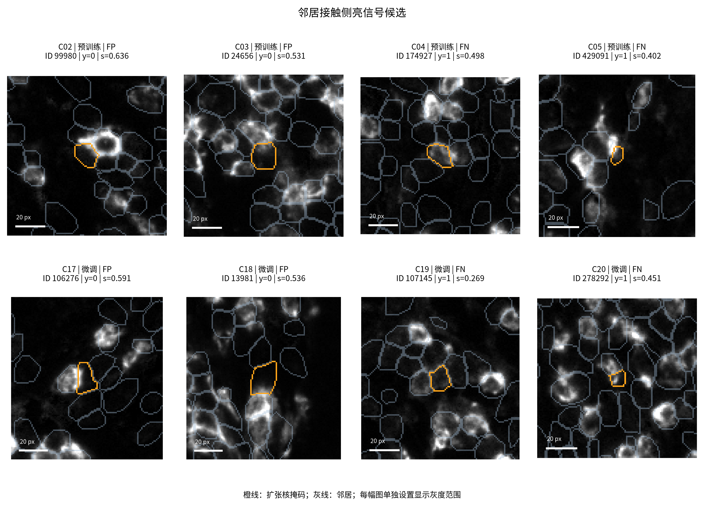
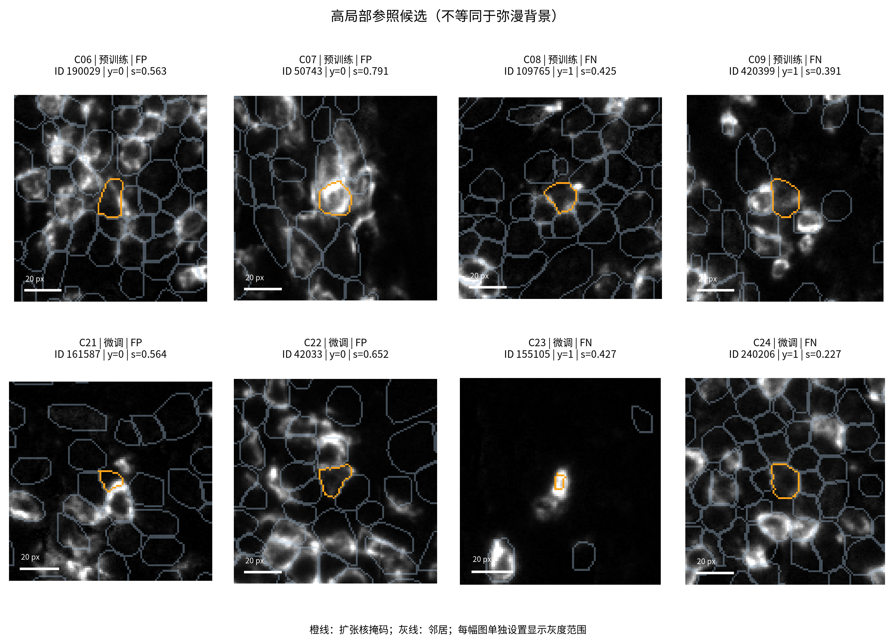
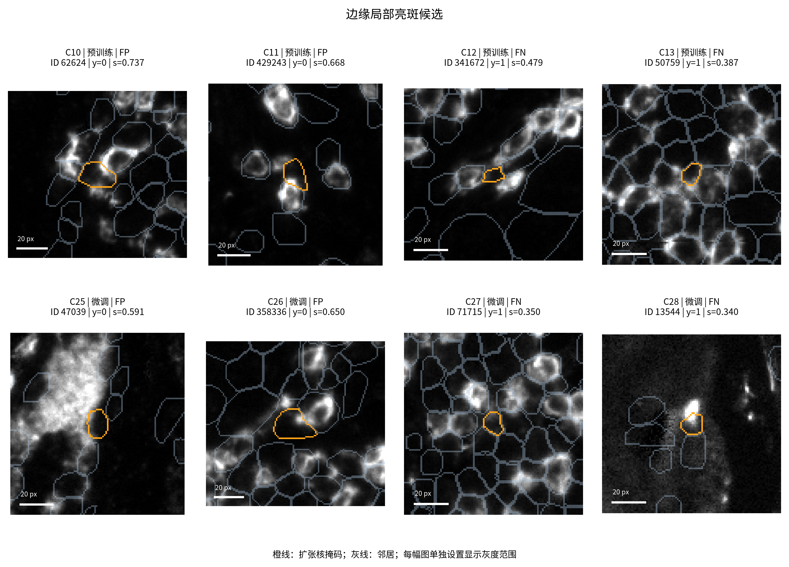
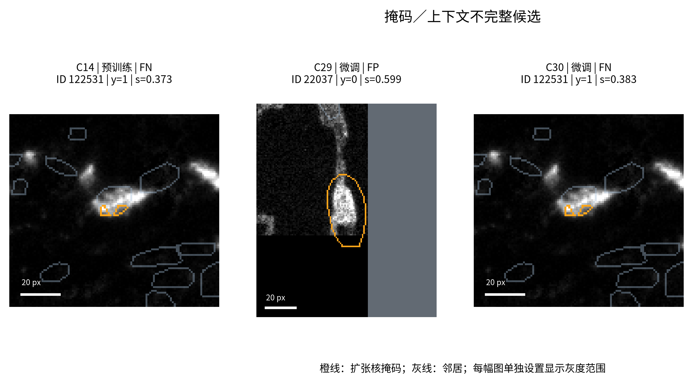

# 开发集案例可视审阅

本轮逐图查看了五类候选中的 31 个模型案例，按四键去重后为 30 个细胞。审阅由本轮助手依据导出的原始 CD8 小图、原实例边界和现有标签完成，不是新增病理专家标注，未修改任何标签或 mask。

逐例记录见 [visual_review_notes.csv](visual_review_notes.csv)，筛选 `case`；图像来源、显示范围、QC 与原始 crop 见 [development_cases.csv](development_cases.csv)。同细胞的三种模型评分见 [case_model_comparison.csv](case_model_comparison.csv)，筛选 `case + model`，列 `score,prediction_official_default,prediction_validation_selected`。

- **弱信号仍会漏检。** C00 的原标签为阳性；GMM 默认判阳，两个 Nimbus 均判阴。图中目标较小、内部偏暗，周围存在更亮结构。该例不能证明所有弱阳性都失败，也不能把不完整亮环视为阴性规则。
- **接触侧亮信号没有被普遍排除。** C02 原标签阴性，目标内部较暗，右上方相邻环状亮信号贴近目标边缘；三种方法默认门限均误报。C18、C22 预训练默认判阴、微调默认判阳，属于微调新增误报示例。只能确认图像属性与错误共存，不能据此证明信号污染机制。
- **高局部参照不等于弥漫背景。** C06–C09、C21–C24 的候选往往包含胞周或邻近亮信号。尤其 C23 为小亮区与大面积暗视野并存，不能作为典型均匀弥漫背景的证据。本轮没有据这些候选确认一组典型弥漫背景案例，也不宣称该错误类型已被模型解决。
- **局部亮斑既可能伴随误报，也可能伴随漏检。** C10、C11、C25、C26 为误报；C12、C13、C27、C28 为漏检。不能由局部边缘亮斑或环形不完整直接推导真实阴阳性。
- **掩码异常与上下文不足需要区分。** C14/C30 是同一细胞，`qc_disconnected=True`，图中原实例分为两小块；两个 Nimbus 均漏检，GMM 默认判阳。C29 为 `qc_context_clipped=True, qc_truncated=False`：邻域支持到图像右缘截止，不能称目标细胞本身被截断；该例预训练与 GMM 默认判阴，微调误报。

这些案例按错误和图像属性筛选，不能用来估计各种形态的真实错误率。模型性能以完整有标签集合的指标 CSV 为依据。橙线代表扩张核掩码；灰线代表其他实例。每图仅为显示设置灰度上限，不能凭不同面板的显示亮度比较绝对强度。

