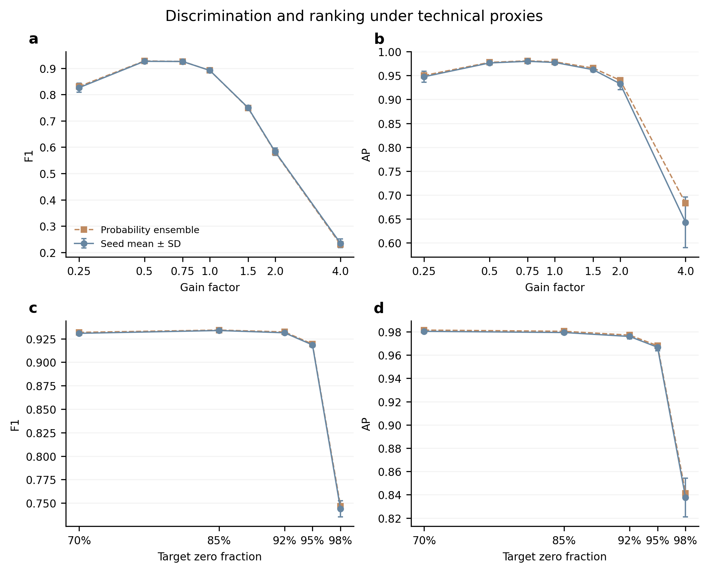
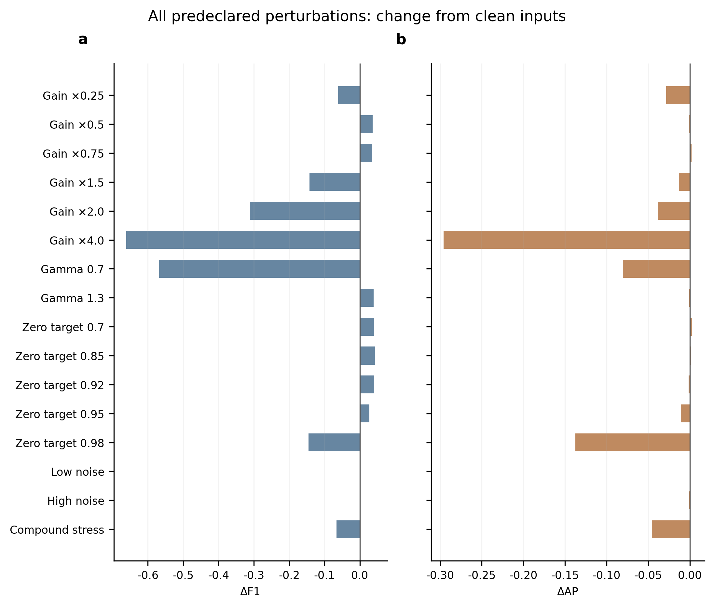
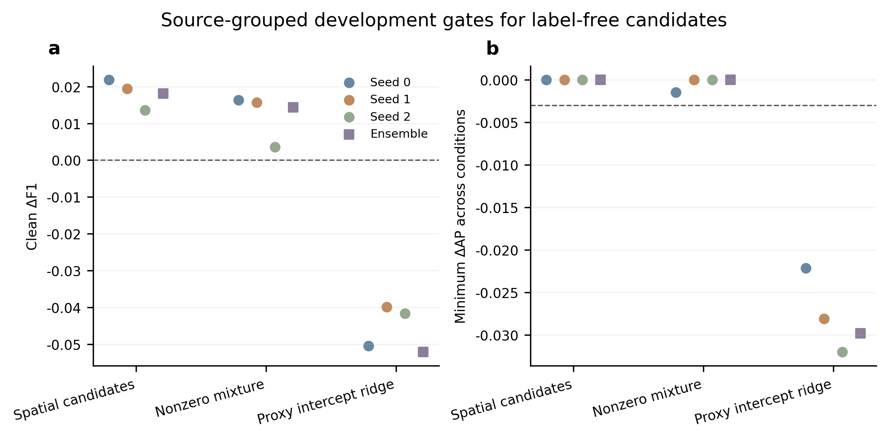
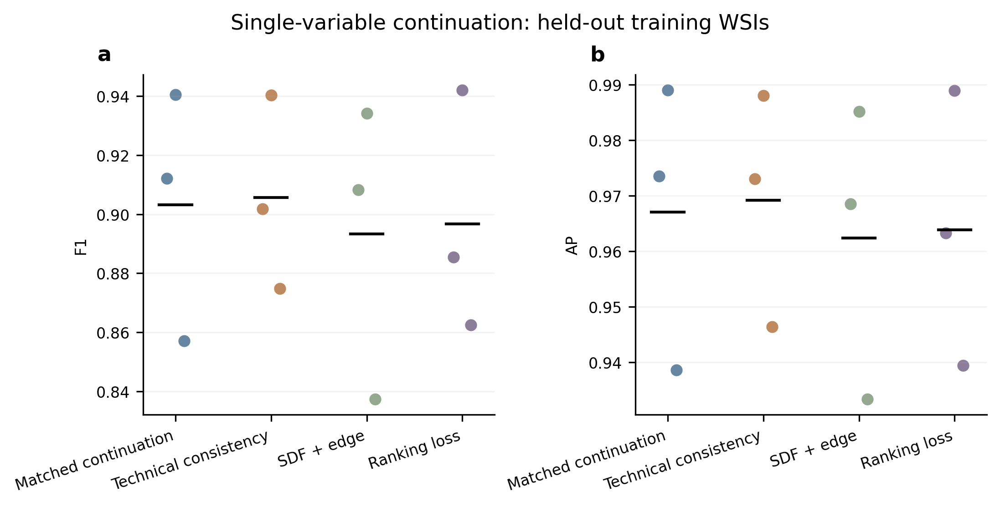
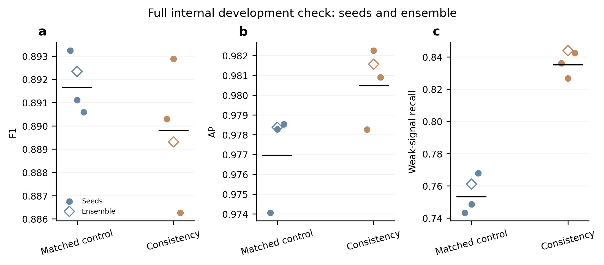
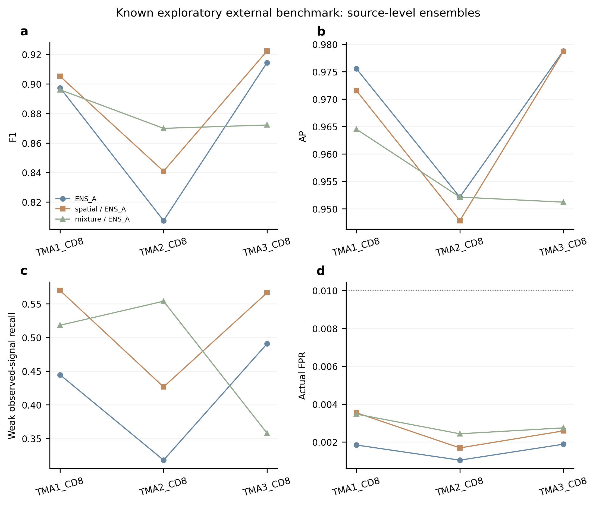
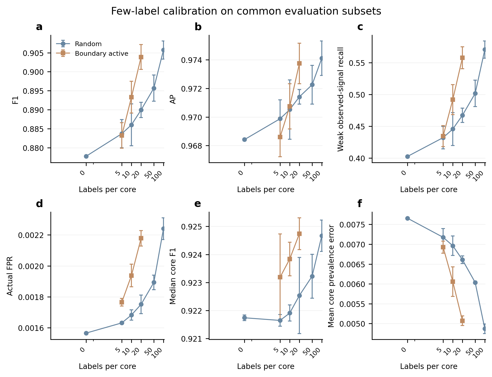

# CD8 missing-computation execution report

The finite, preregistered computation is complete. New label-free candidates met Gate 1: **False**. Boundary-active calibration with at most 20 labels per core met Gate 2: **True**. These are descriptive results on a previously inspected external benchmark, not a new blind test or causal validation.

## What was computed and reused

Stage 0 evaluated 16 changed technical-proxy scenarios on all 539,132 internal cells for each of 3 existing A seeds (48 full seed prediction sets; probability ensembles calculated separately). Clean scores, earlier weights and splits, historical random 0/20/50/100 calibration, the 100 reserved cells per core/repeat and 55 case IDs/images were reused. No old full model fit or full clean prediction was repeated. A1536 cell identity pilot checked cached-score equivalence. New CPU calibration comprised random 5/10 and active 5/10/20 labels for 3 pool repeats,15 groups in total.

New continuation used 3 training-source leave-one-WSI folds, four variants and 12 fits. One selected variant and its matched added-training control then received 3 seeds each (6 finalfits). This is a bounded warm-start study, not a search over all possible SDF, ranking or augmentation methods. Training used no external labels. Internal WSIs were explicitly used for development gates and operating points.

## Technical proxies and their limits

Transform order was published image → existing fixed[L,U] normalization and clipping → synthetic transform; no adaptive renormalization followed. Gain=.25/.5/.75/1.5/2/4; gamma=.7/1.3; zero targets=.70/.85/.92/.95/.98; two heteroscedastic Gaussian shot-noise approximations plus Gaussian read noise; and a compound stress. Noise is in normalized intensity units, not calibrated photon counts. Crop-level noise may differ across overlapping crops; this is not whole-slide acquisition simulation.

The zero-target denominator was 188,378,098 valid labelled-target-instance pixels across 3 internal WSIs, not all tissue pixels. Ties and existing zeros can exceed the requested fraction. Severe information loss was stress-only and was not required to preserve observable labels or logits. Published images already contained the large zero mass before this project clipped them; its upstream cause remains unknown. All-zero cells do not establish biological negatives.

| scenario | F1 | AP | weak_recall | FPR | delta_F1 | delta_AP |
| --- | --- | --- | --- | --- | --- | --- |
| clean | 0.891812 | 0.978756 | 0.767309 | 0.007690 | 0.000000 | 0.000000 |
| gain_0.25 | 0.830530 | 0.950195 | 0.000000 | 0.000106 | -0.061282 | -0.028561 |
| gain_0.5 | 0.927826 | 0.977620 | 0.245185 | 0.001448 | 0.036014 | -0.001136 |
| gain_0.75 | 0.925968 | 0.980818 | 0.598647 | 0.003879 | 0.034156 | 0.002062 |
| gain_1.5 | 0.749217 | 0.965744 | 0.910984 | 0.023836 | -0.142594 | -0.013012 |
| gain_2.0 | 0.580716 | 0.940104 | 0.960958 | 0.052277 | -0.311096 | -0.038652 |
| gain_4.0 | 0.230450 | 0.682850 | 0.995836 | 0.243271 | -0.661361 | -0.295906 |
| gamma_0.7 | 0.323635 | 0.898372 | 0.988548 | 0.152123 | -0.568177 | -0.080385 |
| gamma_1.3 | 0.930587 | 0.977944 | 0.309214 | 0.001728 | 0.038775 | -0.000812 |
| zero_0.7 | 0.931853 | 0.981512 | 0.564289 | 0.003235 | 0.040042 | 0.002755 |
| zero_0.85 | 0.934301 | 0.980459 | 0.444040 | 0.002359 | 0.042490 | 0.001703 |
| zero_0.92 | 0.932324 | 0.977169 | 0.310776 | 0.001628 | 0.040512 | -0.001587 |
| zero_0.95 | 0.919382 | 0.968082 | 0.129620 | 0.001134 | 0.027570 | -0.010674 |
| zero_0.98 | 0.746692 | 0.841307 | 0.000000 | 0.000242 | -0.145120 | -0.137449 |
| noise_low | 0.891727 | 0.978663 | 0.763665 | 0.007678 | -0.000085 | -0.000093 |
| noise_high | 0.891990 | 0.978260 | 0.763665 | 0.007657 | 0.000179 | -0.000497 |
| compound | 0.826294 | 0.933286 | 0.000000 | 0.000090 | -0.065518 | -0.045470 |

OverallF1 can increase while weak observed-signal recall collapses: compare clean and zero 95%rows above. Gain/clipping can also alter ranking. These observations do not establish exposure, dye concentration or background subtraction as the real cause. Stage 0 diagnostic logits clip at float 32 epsilon; calibrators use float 64 epsilon. Neither recovers uncensored network logits at probability endpoints.

## Label-free development

Spatial low-signal candidates and a nonzero two-Gaussian mixture passed all 3 seeds and ensemble gates; proxy ridge failed. Spatial candidates are not known negatives. A low-mean mixture component is not a validated negative class; its boundary is neither localFDR nor anFPR guarantee. Both references and any regression/scaling exclude the held-out internal source and all its derived perturbations. Only 3 independent sourceWSIs underlie this development exercise.

Each external core adapts using only its own observable inputs and the frozen development reference. The input cohort consists of annotated cells with labels hidden during adaptation, not a census of all unannotated tissue instances. No TMA identifier or positive fraction is forced as a target. No physical intensity standard has been recovered.

## Continuation gates and stopped branches

Physics was selected by training-source cross-validation. SDF+edge and ranking did not pass that gate and received no final fits. The SDF branch had 288 additional nominal convolution weights; effective used capacity is not exactly matched. Other variants shared parent weights and epoch-index hashes. Parameters and samples were recorded before optimizer updates, not reconstructed afterwards.

Physics eligibility required nonzero target signal, at least 50%nonzero-count and integrated-signal retention, at most 2%target saturation, and synthetic noise RMS ratio≥3 where applicable. Failing views used clean cross-entropy only. This noise ratio is a proxy with known simulated variance, not physical SNR. Noncontact edge strips can still contain PSF spillover,2 D overlap or segmentation error.

| variant | fold | F1 | AP | P | R | FPR |
| --- | --- | --- | --- | --- | --- | --- |
| control | 0 | 0.912068 | 0.973559 | 0.894387 | 0.930464 | 0.009717 |
| physics | 0 | 0.901797 | 0.973038 | 0.863198 | 0.944010 | 0.013231 |
| sdf | 0 | 0.908289 | 0.968550 | 0.887421 | 0.930163 | 0.010436 |
| ranking | 0 | 0.885423 | 0.963278 | 0.836997 | 0.939795 | 0.016186 |
| control | 1 | 0.940432 | 0.989060 | 0.912258 | 0.970403 | 0.023347 |
| physics | 1 | 0.940357 | 0.988030 | 0.914912 | 0.967257 | 0.022501 |
| sdf | 1 | 0.934105 | 0.985195 | 0.918940 | 0.949779 | 0.020957 |
| ranking | 1 | 0.942016 | 0.988946 | 0.916281 | 0.969238 | 0.022152 |
| control | 2 | 0.857072 | 0.938594 | 0.909757 | 0.810156 | 0.026563 |
| physics | 2 | 0.874803 | 0.946426 | 0.909914 | 0.842301 | 0.027564 |
| sdf | 2 | 0.837333 | 0.933311 | 0.914483 | 0.772187 | 0.023868 |
| ranking | 2 | 0.862482 | 0.939391 | 0.906547 | 0.822502 | 0.028026 |

| model | F1 | AP | P | R | weak_recall | FPR |
| --- | --- | --- | --- | --- | --- | --- |
| NEW_control_s0 | 0.893229 | 0.974062 | 0.827996 | 0.969620 | 0.743363 | 0.007342 |
| NEW_physics_s0 | 0.890287 | 0.978266 | 0.814813 | 0.981171 | 0.836023 | 0.008128 |
| NEW_control_s1 | 0.891110 | 0.978281 | 0.821561 | 0.973523 | 0.748568 | 0.007707 |
| NEW_physics_s1 | 0.892884 | 0.982243 | 0.819247 | 0.981065 | 0.826653 | 0.007890 |
| NEW_control_s2 | 0.890587 | 0.978533 | 0.819961 | 0.974525 | 0.767829 | 0.007799 |
| NEW_physics_s2 | 0.886267 | 0.980905 | 0.807069 | 0.982700 | 0.842270 | 0.008563 |
| NEW_ENS_control | 0.892336 | 0.978373 | 0.823346 | 0.973945 | 0.761062 | 0.007617 |
| NEW_ENS_physics | 0.889313 | 0.981560 | 0.811991 | 0.982911 | 0.843831 | 0.008295 |

Final clean-internal gate passed: **False**. Ensemble deltas versus matched control: AP=+0.003187, F1=-0.003023. Mean seedF1 delta=-0.001829. The branch stopped at this gate. Its planned 3 scenario synthetic follow-up and all new-model external predictions were NOT executed; no replacement candidate was tried.

## Known exploratory external benchmark

All 437,480 external labelled cells are retained in zero-label evaluation. Thresholds use strict score>threshold and tie-aware negative order statistics, taking the maximum across 3 internalWSIs. Actual external FPR is reported and is not guaranteed to meet 1%. Fixed 0.5 results remain separate in the complete CSV. Ensemble probabilities are not averages of seed metrics; seed mean±SD is provided separately.

| model | method | F1 | AP | P | R | weak_recall | FPR | core_F1_median | core_F1_IQR | core_prevalence_MAE |
| --- | --- | --- | --- | --- | --- | --- | --- | --- | --- | --- |
| ENS_A | reused_baseline | 0.877957 | 0.968485 | 0.965164 | 0.805204 | 0.402836 | 0.001563 | 0.922247 | 0.034160 | 0.007649 |
| OLD_ENS_image_target_other | reused_baseline | 0.880303 | 0.964634 | 0.960950 | 0.812145 | 0.413549 | 0.001775 | 0.925800 | 0.033292 | 0.007177 |
| ENS_A | spatial | 0.892868 | 0.965876 | 0.946300 | 0.845148 | 0.507091 | 0.002580 | 0.922408 | 0.037314 | 0.006078 |
| ENS_A | mixture | 0.879468 | 0.955283 | 0.939261 | 0.826833 | 0.488232 | 0.002876 | 0.923633 | 0.055918 | 0.008320 |

[All pooled/source/core results](../results/ALL_EXTERNAL_SIX_METRICS.csv); [seed means and SD](../results/ALL_EXTERNAL_SEED_MEAN_SD.csv); [paired core deltas](../results/PAIRED_CORE_DELTAS.csv); [source-level core summaries](../results/SOURCE_CORE_MACRO_SUMMARY.csv); [frozen proxy strata](../results/EXTERNAL_PROXY_STRATA.csv). TMA1/2 share samples, core is not an independent patient, and patient/staining-batch mappings remain unknown. Weak signal uses original positive labels plus a frozen observed normalized-signal cutoff0.17319928197733186, not independent biological adjudication.

## Independent target-label calibration

Each of 3 pool repeats excludes the same 4200 reserved cells (100 per core), leaving 433,280 common evaluation cells for all budgets. Active sampling selects topKclosest native logits to the frozen decision boundary, with the pre-existing hash order resolving ties. Its regularized intercept assumes a usable boundary-selected relationship; deterministic topK has no valid inverse-propensity weights. No IPW or unsupported isotonic fit is used. A single-class pool falls back to zero shift; zero-shift/native-dtype strict-threshold decisions are preserved. Positive effects would not prove intercept drift is the main or sole error mechanism.

| strategy | budget | F1_mean | F1_std | AP_mean | weak_recall_mean | FPR_mean | core_F1_median_mean | core_F1_IQR_mean | core_prevalence_MAE_mean |
| --- | --- | --- | --- | --- | --- | --- | --- | --- | --- |
| active_boundary | 5 | 0.883220 | 0.003347 | 0.968602 | 0.434676 | 0.001765 | 0.923189 | 0.037631 | 0.006927 |
| active_boundary | 10 | 0.893291 | 0.004193 | 0.970746 | 0.492158 | 0.001938 | 0.923838 | 0.033156 | 0.006058 |
| active_boundary | 20 | 0.903875 | 0.003268 | 0.973748 | 0.557923 | 0.002178 | 0.924742 | 0.032713 | 0.005071 |
| random | 5 | 0.883678 | 0.003714 | 0.969880 | 0.432245 | 0.001631 | 0.921648 | 0.034390 | 0.007175 |
| random | 10 | 0.886013 | 0.005488 | 0.970520 | 0.445734 | 0.001682 | 0.921911 | 0.034390 | 0.006963 |
| random_reused | 0 | 0.877756 | 0.000153 | 0.968423 | 0.402697 | 0.001566 | 0.921743 | 0.034700 | 0.007656 |
| random_reused | 20 | 0.889939 | 0.002016 | 0.971413 | 0.467385 | 0.001751 | 0.922537 | 0.034103 | 0.006609 |
| random_reused | 50 | 0.895684 | 0.003431 | 0.972259 | 0.501858 | 0.001893 | 0.923225 | 0.032116 | 0.006036 |
| random_reused | 100 | 0.905721 | 0.002397 | 0.974114 | 0.570795 | 0.002241 | 0.924668 | 0.032766 | 0.004869 |

Gate 2 is passed by the replicate mean only: repeat 101(F1=.906091,weak recall=.571581) and 102(.905412,.563822) pass, while repeat 103(.900122,.538368) does not. Error bars are variation across 3 reserved-pool repeats, not model-seed or patient uncertainty. Historical random 20/50/100 results were reused, not fitted again. Calibration labels and common evaluation labels are disjoint.

Core-level caution: spatial calibration improvedF1 in 27 of 42 cores, worsened 14 and tied 1; mixture improved 22 and worsened 20. Eachcore AP is exactly unchanged by either scalar intercept shift, so pooledAP changes reflect cross-core ordering, not improved within-core discrimination. Spatial mean core prevalence MAE=.00607778 versus native.00764902. In active 20 repeat 103, onecore reachedFPR=.012825, above 1%, despite a much lower pooledFPR.

## Targets and audit

| AP | F1 | FPR | external_target_not_selection | method | model | passed_goal | weak_recall |
| --- | --- | --- | --- | --- | --- | --- | --- |
| 0.968485 | 0.877957 | 0.001563 | True | reused_baseline | ENS_A | False | 0.402836 |
| 0.964634 | 0.880303 | 0.001775 | True | reused_baseline | OLD_ENS_image_target_other | False | 0.413549 |
| 0.965876 | 0.892868 | 0.002580 | True | spatial | ENS_A | False | 0.507091 |
| 0.955283 | 0.879468 | 0.002876 | True | mixture | ENS_A | False | 0.488232 |

| F1_replicate_mean | budget | passed_goal | strategy | weak_recall_replicate_mean |
| --- | --- | --- | --- | --- |
| 0.883220 | 5 | False | active_boundary | 0.434676 |
| 0.893291 | 10 | False | active_boundary | 0.492158 |
| 0.903875 | 20 | True | active_boundary | 0.557923 |
| 0.883678 | 5 | False | random | 0.432245 |
| 0.886013 | 10 | False | random | 0.445734 |
| 0.877756 | 0 | False | random_reused | 0.402697 |
| 0.889939 | 20 | False | random_reused | 0.467385 |

Gate 1 required F1≥.892,AP≥.966,weak recall≥.48 and actualFPR≤.005. Gate 2 required F1≥.902 and weak recall≥.54 with≤20 labels per core. They are conjunctions, not guaranteed endpoints. External failures did not trigger candidate replacement or retuning.

14 inherited tests,17 new tests and 1 synthetic-gate integration check passed. Stage 0 has 136 independent metric checks. Final audit checked 59 metric groups, maximum absolute error 6.66 e-16; verified 18 new weight hashes and 12 paired epoch records. Neural active-wall charge=5397.58 s (1.499 h), below 28800 s. CPU development and audits are accounted separately. A supplementary independent zero-label development replay is included in results.

[Budget detail](../results/BUDGET_BREAKDOWN.json); [final audit](../results/FINAL_AUDIT_COMPLETE.json); [zero-label development audit](../results/ZERO_DEVELOPMENT_AUDIT_COMPLETE.json); [execution ledger](../EXPERIMENT_LEDGER.md). All original files and explicit pretraining correctness amendments are preserved with hashes. Code-version records distinguish the initial freeze from actual amended execution code.

## Real-case review and delivery boundaries

Prediction coverage is explicit:27 internal cases include matched-control/physics predictions;28 external cases include passed zero-label methods and supervised-calibration comparisons. No new-model external case score exists after the internal gate failed. The 55 fixed cases retain 55 raw crops and 110 bilingual figures byte-for-byte. New prediction tables distinguish reserved/excluded cases from actually selected calibration examples. Images may display earlier experiment scores; new scores are in the accompanying table. Pixel scale is not a physical calibration. Display QA is complete only after the visual QA record is written; expert biological adjudication remains pending. No external review changes training labels.

[English55case browser](../review/README.md); [fixed IDs and pending adjudication](../review/README.md); [prediction comparison](../review/README.md).

Further work requires expert signal-attribution review and better acquisition/segmentation metadata. These results support bounded conclusions about this dataset and these configurations; they do not justify fitting indefinitely against the known external labels.

Publication evidence: [table index](../TABLE_INDEX.csv), [claim index](../CONCLUSION_INDEX.csv), [publication scope](../PUBLICATION_NOTES.md). Individual-level materials remain outside this repository.
