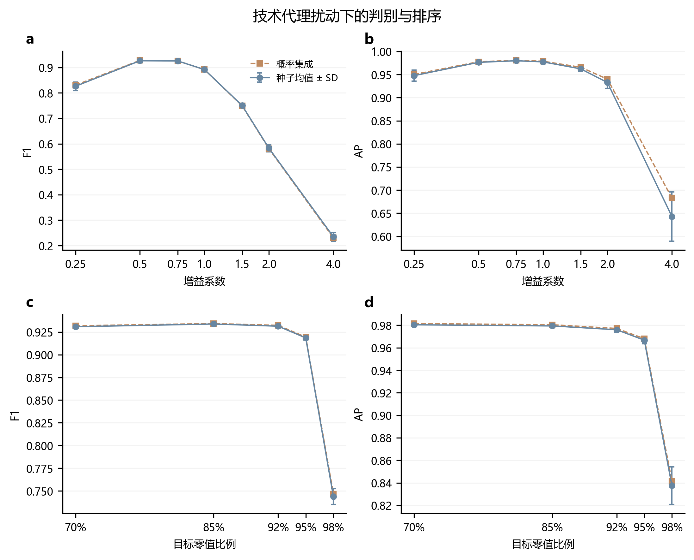
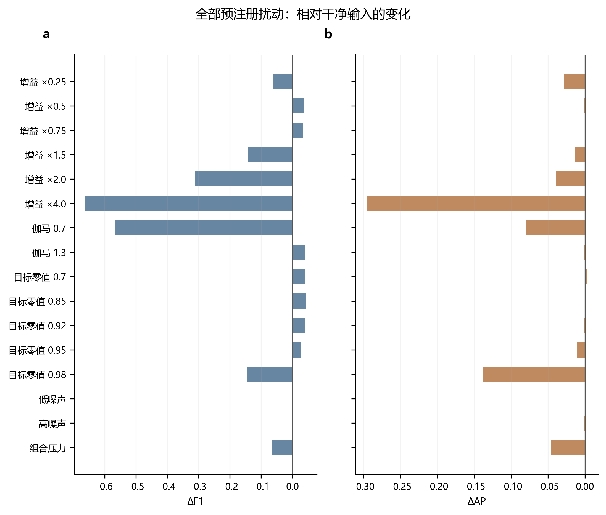
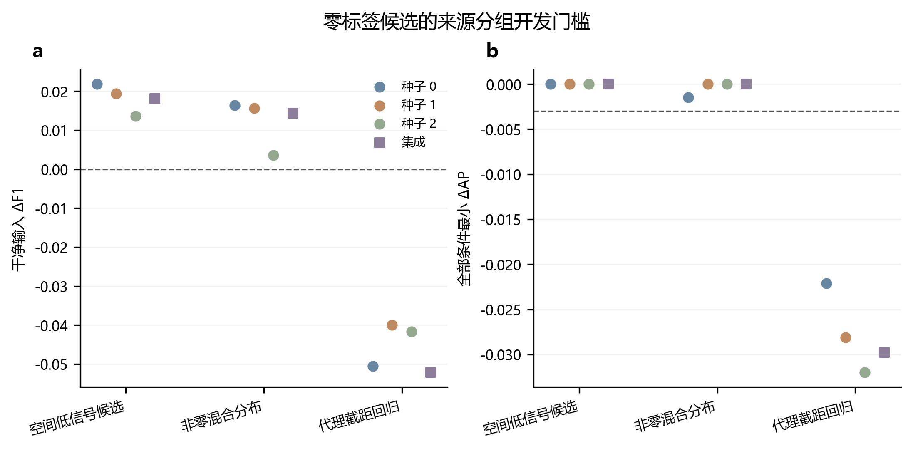
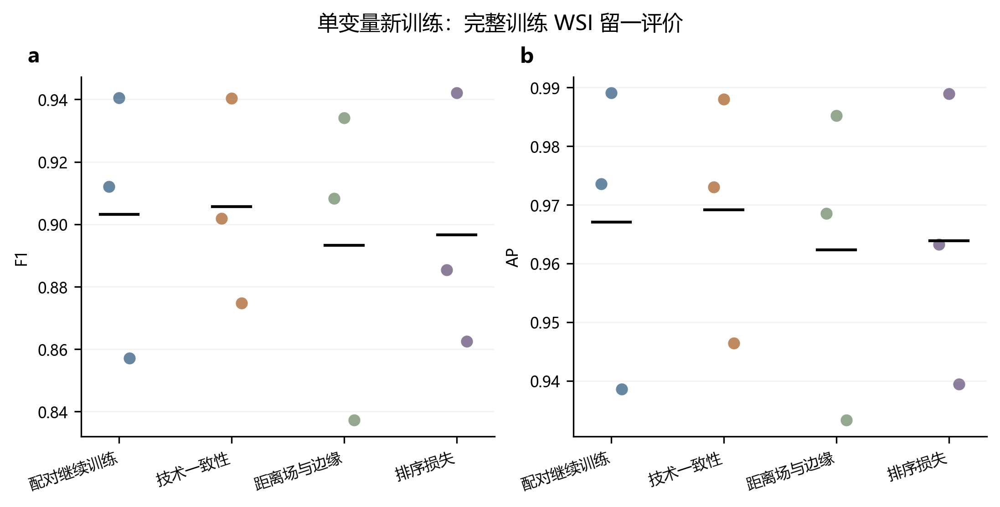
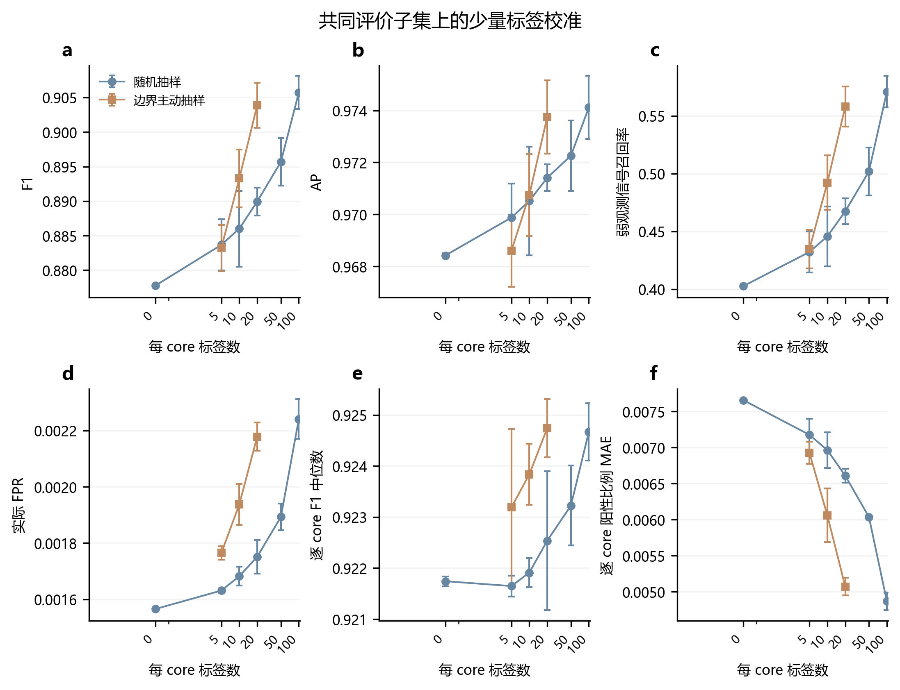
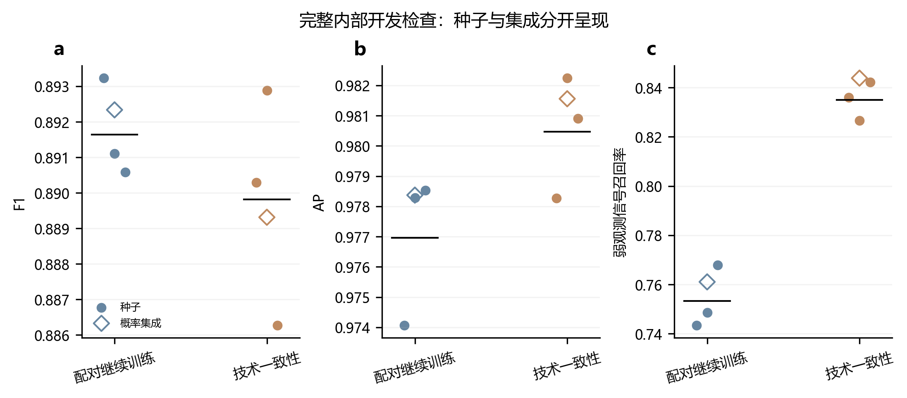
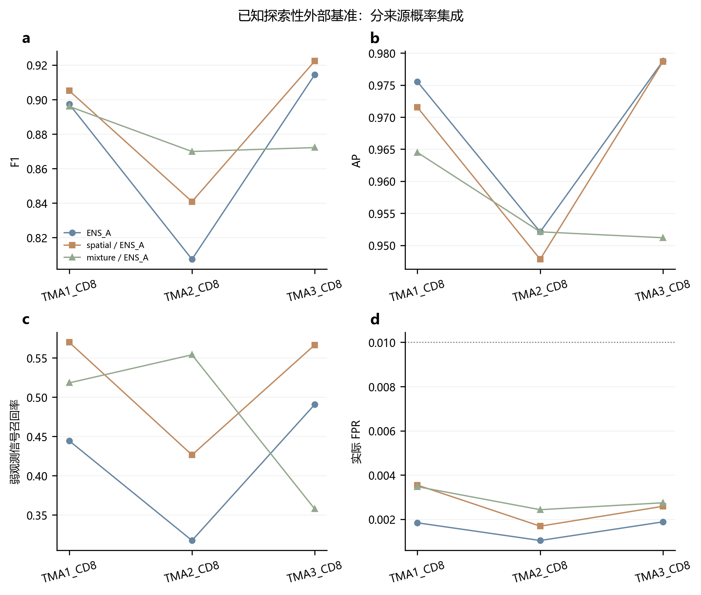

# CD8 缺失计算执行报告

本轮按上传目标补齐计算并复用历史结果。新增零标签方法未达到预注册 Gate1 的联合目标。主动 ≤20 标签方案达到 Gate2 的数值目标。这些结论仅适用于已反复查看的探索性外部基准，不构成新盲测或独立患者验证。

## 完成边界与复用

- 已完成：内部全量 539,132 细胞 ×16 种技术代理扰动 ×3 旧 A 种子；新增校准开发；随机5/10与主动5/10/20标签计算；六指标、逐来源/逐core表、固定55病例预测对照和独立审计。

- 直接复用：旧模型权重、完整干净预测、数据划分、每次重复每core100个预留池、随机20/50/100标签结果及55病例图像。旧模型拟合、旧消融和这些历史校准预算均未重跑。

- 新训练边界：开发选中 physics；最终内部门槛 False。 固定4组包含额外训练步数相同的继续训练对照；新阶段从旧折/种子权重继续，所有旧产物保留。

- 仍未完成：55例专家生物学判读；实际曝光、染色浓度、PSF、患者及真实染色批次校准。这些依赖当前缺失的物理对照或元数据。

## 数据与协议边界

训练3张WSI、内部3张WSI、外部42个core。TMA1/2含同源样本，core不等于独立患者。原标签和四键ID保持固定，Pan-M未访问。弱信号定义沿用“原阳性标签且训练冻结观测信号≤0.17319928197733186”；不是专家独立确认的生物学弱阳性。

外部94.85%零像素已在项目裁剪前存在，但上游原因未知。全零细胞不能证明生物真阴性；无邻居接触边缘仍可能有PSF溢出、二维重叠和分割误差。截距校准有用不证明主要或唯一错误就是截距漂移。

协议 SHA256：`45780b17daf7e19cdc4039b6c19253f0bf886a11e2402cc698e4c93d9fea5f25`。追加的条件训练计划在任何新增外部评价前冻结；其增强适用条件在新训练前因数学审计收紧（保留原版和独立修订记录），未依据外部性能修改；没有依据外部结果调参、换阈值或重选模型。

## Stage0：全量技术代理扰动

变换顺序为：发布图像→既有固定[L,U]归一化及裁剪→合成变换；之后不再按切片重归一化。乘性增益为0.25/0.5/0.75/1.5/2/4，gamma为0.7/1.3，目标零值比例为70/85/92/95/98%；另有低/高异方差高斯散粒噪声近似加读出噪声、组合压力。噪声量纲为归一化U−L单位。组合顺序为增益0.4→读出噪声σ0.01→95%分位下界减除→裁剪。

保存的概率为float32。Stage0诊断logit使用float32 epsilon裁剪（约1.19e-7）；校准器使用float64 epsilon（约2.22e-16）。它们是概率导出的有限logit代理，不是完整网络原始logit；概率端点的信息不能逆向恢复，不能据均值变化作唯一因果解释。新训练一致性损失则直接作用于网络两个输出logit之差。

这些是裁剪级代理；重叠裁剪的噪声可不同，不是整幅物理仿真。零比例分母为3张内部WSI的有限有效已标注目标实例像素，共188,378,098像素，不等于全组织像素。分位同分和已有零值可使实际零比例高于目标，逐来源分母/实际比例保存在表中。严重信息损失只作压力测试，未强制可观测标签或logit完全不变。

干净 ENS_A：F1=0.891812，AP=0.978756。排序损失最大的预注册条件为 `gain_4.0`：ΔF1=-0.661361，ΔAP=-0.295906。因此本实验应分别看排序损失和工作点变化，不能仅由logit均值漂移推断误差机制。

| scenario | F1 | AP | P | R | FPR | weak_recall | flip_rate | delta_F1 | delta_AP | AP_retention | delta_mean_logit |
| --- | --- | --- | --- | --- | --- | --- | --- | --- | --- | --- | --- |
| clean | 0.891812 | 0.978756 | 0.822040 | 0.974525 | 0.007690 | 0.767309 | 0.000000 | 0.000000 | 0.000000 | 1.000000 | 0.000000 |
| gain_0.25 | 0.830530 | 0.950195 | 0.995944 | 0.712236 | 0.000106 | 0.000000 | 0.016541 | -0.061282 | -0.028561 | 0.970819 | -1.783061 |
| gain_0.5 | 0.927826 | 0.977620 | 0.957725 | 0.899736 | 0.001448 | 0.245185 | 0.008653 | 0.036014 | -0.001136 | 0.998839 | -1.246539 |
| gain_0.75 | 0.925968 | 0.980818 | 0.899622 | 0.953903 | 0.003879 | 0.598647 | 0.004402 | 0.034156 | 0.002062 | 1.002107 | -0.657667 |
| gain_1.5 | 0.749217 | 0.965744 | 0.602380 | 0.990717 | 0.023836 | 0.910984 | 0.016148 | -0.142594 | -0.013012 | 0.986706 | 1.348544 |
| gain_2.0 | 0.580716 | 0.940104 | 0.409836 | 0.995992 | 0.052277 | 0.960958 | 0.043774 | -0.311096 | -0.038652 | 0.960509 | 2.602004 |
| gain_4.0 | 0.230450 | 0.682850 | 0.130241 | 0.999420 | 0.243271 | 0.995836 | 0.228191 | -0.661361 | -0.295906 | 0.697671 | 6.015012 |
| gamma_0.7 | 0.323635 | 0.898372 | 0.193103 | 0.998787 | 0.152123 | 0.988548 | 0.140214 | -0.568177 | -0.080385 | 0.917871 | 5.220474 |
| gamma_1.3 | 0.930587 | 0.977944 | 0.950550 | 0.911445 | 0.001728 | 0.309214 | 0.007970 | 0.038775 | -0.000812 | 0.999171 | -1.342314 |
| zero_0.7 | 0.931853 | 0.981512 | 0.914534 | 0.949842 | 0.003235 | 0.564289 | 0.005173 | 0.040042 | 0.002755 | 1.002815 | -1.314194 |
| zero_0.85 | 0.934301 | 0.980459 | 0.935165 | 0.933439 | 0.002359 | 0.444040 | 0.006596 | 0.042490 | 0.001703 | 1.001740 | -1.483665 |
| zero_0.92 | 0.932324 | 0.977169 | 0.953315 | 0.912236 | 0.001628 | 0.310776 | 0.008043 | 0.040512 | -0.001587 | 0.998378 | -1.588902 |
| zero_0.95 | 0.919382 | 0.968082 | 0.965743 | 0.877268 | 0.001134 | 0.129620 | 0.009745 | 0.027570 | -0.010674 | 0.989095 | -1.669959 |
| zero_0.98 | 0.746692 | 0.841307 | 0.989041 | 0.599736 | 0.000242 | 0.000000 | 0.020366 | -0.145120 | -0.137449 | 0.859568 | -1.979659 |
| noise_low | 0.891727 | 0.978663 | 0.822197 | 0.974103 | 0.007678 | 0.763665 | 0.000330 | -0.000085 | -0.000093 | 0.999905 | 0.018006 |
| noise_high | 0.891990 | 0.978260 | 0.822607 | 0.974156 | 0.007657 | 0.763665 | 0.000890 | 0.000179 | -0.000497 | 0.999493 | 0.352191 |
| compound | 0.826294 | 0.933286 | 0.996500 | 0.705749 | 0.000090 | 0.000000 | 0.016784 | -0.065518 | -0.045470 | 0.953543 | -1.967569 |

数据：[完整三种子及集成、逐WSI指标](../results/STAGE0_FULL_METRICS.csv)；[实际零比例与分母](../results/STAGE0_PIXEL_DENOMINATORS.csv)。

## 零标签自校准

有限候选为：空间低信号候选分位对齐、剔除全零目标后的双高斯混合低均值分量边界对齐、3个无标签代理摘要的强正则截距回归。空间候选不称真阴性；混合边界不称lfdr或FPR保证；回归输出不解释为已恢复物理强度。摘要和锚点限于现有评价细胞队列（计算时不读取其标签），不是全组织未标注实例普查；队列组成的部署适用性仍待独立验证。每core仅用其自身无标签输入，参考与回归拟合来自内部开发WSI。

内部按来源WSI留一，同一来源的全部派生扰动整体隔离。插补/摘要缩放/回归标签均不接触heldout来源；三个WSI才是有效来源数量，不能把派生扰动当作独立切片。门槛为干净F1不降且所有条件AP下降不超过0.003，三种子与集成都通过才做外部评价。

| 候选 | 全部三种子及集成通过 | 失败原因 |
| --- | --- | --- |
| mixture | True | 无 |
| ridge | False | A_s0:clean_F1_degradation,gain_2.0:AP_loss_gt_.003,zero_0.98:AP_loss_gt_.003; A_s1:clean_F1_degradation,zero_0.98:AP_loss_gt_.003; A_s2:clean_F1_degradation,zero_0.98:AP_loss_gt_.003; ENS_A:clean_F1_degradation,zero_0.98:AP_loss_gt_.003 |
| spatial | True | 无 |

[完整开发指标](../results/ZERO_LABEL_DEV_METRICS.csv)；[来源隔离与拟合记录](../provenance/ZERO_LABEL_SOURCE_FOLDS.json)。

## 有限单变量继续训练

从正确的旧训练WSI留一权重开始，每折额外2epoch×20,000样本；对照和三候选使用相同采样哈希。物理一致性只对至少保留50%目标非零像素与50%目标积分信号、饱和≤2%，且加入合成噪声时原信号RMS/已知噪声RMS代理≥3的有信号视图使用变换分类/Huber损失；严重信息损失视图不强制一致。距离场与非接触边缘使用像素尺度，不能称无污染膜。SDF分支比对照增加288个名义权重，名义参数含未使用支路，并非严格有效容量相等；对照匹配额外更新数，实耗预算单独记录。排序损失的弱正例/邻居负例界限仅由每折拟合来源确定。

训练开发选择：`physics`；最终干净内部门槛：`False`。若预注册合成条件的任一种子或集成AP比配对对照下降超过0.003，则停止在合成门槛，不做新模型外部推理。所有决策见[开发选择](../models/CONTINUATION_CV_SELECTION.json)与[内部门槛](../models/CONTINUATION_INTERNAL_GATE.json)。

| variant | fold | heldout_training_WSI | F1 | AP | P | R | FPR |
| --- | --- | --- | --- | --- | --- | --- | --- |
| control | 0 | training_WSIs/WSI1 | 0.912068 | 0.973559 | 0.894387 | 0.930464 | 0.009717 |
| physics | 0 | training_WSIs/WSI1 | 0.901797 | 0.973038 | 0.863198 | 0.944010 | 0.013231 |
| sdf | 0 | training_WSIs/WSI1 | 0.908289 | 0.968550 | 0.887421 | 0.930163 | 0.010436 |
| ranking | 0 | training_WSIs/WSI1 | 0.885423 | 0.963278 | 0.836997 | 0.939795 | 0.016186 |
| control | 1 | training_WSIs/WSI2 | 0.940432 | 0.989060 | 0.912258 | 0.970403 | 0.023347 |
| physics | 1 | training_WSIs/WSI2 | 0.940357 | 0.988030 | 0.914912 | 0.967257 | 0.022501 |
| sdf | 1 | training_WSIs/WSI2 | 0.934105 | 0.985195 | 0.918940 | 0.949779 | 0.020957 |
| ranking | 1 | training_WSIs/WSI2 | 0.942016 | 0.988946 | 0.916281 | 0.969238 | 0.022152 |
| control | 2 | training_WSIs/WSI3 | 0.857072 | 0.938594 | 0.909757 | 0.810156 | 0.026563 |
| physics | 2 | training_WSIs/WSI3 | 0.874803 | 0.946426 | 0.909914 | 0.842301 | 0.027564 |
| sdf | 2 | training_WSIs/WSI3 | 0.837333 | 0.933311 | 0.914483 | 0.772187 | 0.023868 |
| ranking | 2 | training_WSIs/WSI3 | 0.862482 | 0.939391 | 0.906547 | 0.822502 | 0.028026 |

## 已知探索性外部结果：零标签

以下为概率集成；固定0.5与冻结内部逐WSI1%FPR工作点另列于完整CSV。内部FPR规则不保证外部FPR。逐core F1中位数/IQR和平均阳性比例绝对误差是描述统计，不能当作独立患者推断。

| model | method | F1 | AP | P | R | weak_recall | FPR | core_F1_median | core_F1_IQR | core_prevalence_MAE |
| --- | --- | --- | --- | --- | --- | --- | --- | --- | --- | --- |
| ENS_A | reused_baseline | 0.877957 | 0.968485 | 0.965164 | 0.805204 | 0.402836 | 0.001563 | 0.922247 | 0.034160 | 0.007649 |
| OLD_ENS_image_target_other | reused_baseline | 0.880303 | 0.964634 | 0.960950 | 0.812145 | 0.413549 | 0.001775 | 0.925800 | 0.033292 | 0.007177 |
| ENS_A | spatial | 0.892868 | 0.965876 | 0.946300 | 0.845148 | 0.507091 | 0.002580 | 0.922408 | 0.037314 | 0.006078 |
| ENS_A | mixture | 0.879468 | 0.955283 | 0.939261 | 0.826833 | 0.488232 | 0.002876 | 0.923633 | 0.055918 | 0.008320 |

逐来源结果：

| model | method | unit | n | P | R | F1 | AP | weak_recall | FPR |
| --- | --- | --- | --- | --- | --- | --- | --- | --- | --- |
| ENS_A | reused_baseline | TMA1_CD8 | 145701 | 0.960056 | 0.842358 | 0.897365 | 0.975534 | 0.444444 | 0.001842 |
| ENS_A | reused_baseline | TMA2_CD8 | 158379 | 0.967847 | 0.692588 | 0.807402 | 0.952096 | 0.317577 | 0.001043 |
| ENS_A | reused_baseline | TMA3_CD8 | 133400 | 0.967812 | 0.866634 | 0.914433 | 0.978754 | 0.490657 | 0.001885 |
| OLD_ENS_image_target_other | reused_baseline | TMA1_CD8 | 145701 | 0.953820 | 0.854453 | 0.901406 | 0.974838 | 0.473407 | 0.002174 |
| OLD_ENS_image_target_other | reused_baseline | TMA2_CD8 | 158379 | 0.965755 | 0.694044 | 0.807660 | 0.944765 | 0.314776 | 0.001115 |
| OLD_ENS_image_target_other | reused_baseline | TMA3_CD8 | 133400 | 0.964016 | 0.873596 | 0.916581 | 0.977138 | 0.503470 | 0.002132 |
| ENS_A | spatial | TMA1_CD8 | 145701 | 0.928964 | 0.882490 | 0.905131 | 0.971537 | 0.569774 | 0.003547 |
| ENS_A | spatial | TMA2_CD8 | 158379 | 0.952794 | 0.752439 | 0.840846 | 0.947822 | 0.426471 | 0.001690 |
| ENS_A | spatial | TMA3_CD8 | 133400 | 0.957419 | 0.889717 | 0.922327 | 0.978670 | 0.566471 | 0.002588 |
| ENS_A | mixture | TMA1_CD8 | 145701 | 0.929025 | 0.865311 | 0.896036 | 0.964492 | 0.518167 | 0.003475 |
| ENS_A | mixture | TMA2_CD8 | 158379 | 0.937868 | 0.811126 | 0.869905 | 0.952105 | 0.553922 | 0.002435 |
| ENS_A | mixture | TMA3_CD8 | 133400 | 0.950447 | 0.805813 | 0.872174 | 0.951185 | 0.357715 | 0.002747 |

[全部来源/core与两种阈值规则](../results/ALL_EXTERNAL_SIX_METRICS.csv)；[三种子均值±SD](../results/ALL_EXTERNAL_SEED_MEAN_SD.csv)；[配对core差值](../results/PAIRED_CORE_DELTAS.csv)；[每来源的core中位数/IQR及平均比例误差](../results/SOURCE_CORE_MACRO_SUMMARY.csv)；[弱信号、拥挤、接触亮阴性、目标零与边界代理分层](../results/EXTERNAL_PROXY_STRATA.csv)。这些自动分层不是专家信号归属判读。概率集成不等于种子指标均值。

## 少量目标标签：独立赛道

固定ENS_A先对三种子概率求均值，然后每core拟合正则截距。随机5/10为新对照；主动5/10/20在已有100候选池内按到冻结边界的logit距离取topK，并以原hash次序处理同分。确定性topK没有合法逆倾向权重，故未使用IPW；校准效果依赖边界采样下的模型假设，不能声称总体无偏。单类抽样回退至原阈值，0截距与native dtype严格`>`语义保持一致。

每次重复排除同一4200预留细胞，所有模型/预算共同评价433280细胞；重复101/102/103。下表均值±SD的变异来源为预留池重复，不是模型种子或患者。随机0/20/50/100直接复用历史计算。

| strategy | budget | F1_mean | F1_std | AP_mean | weak_recall_mean | FPR_mean | core_F1_median_mean | core_F1_IQR_mean | core_prevalence_MAE_mean |
| --- | --- | --- | --- | --- | --- | --- | --- | --- | --- |
| active_boundary | 5 | 0.883220 | 0.003347 | 0.968602 | 0.434676 | 0.001765 | 0.923189 | 0.037631 | 0.006927 |
| active_boundary | 10 | 0.893291 | 0.004193 | 0.970746 | 0.492158 | 0.001938 | 0.923838 | 0.033156 | 0.006058 |
| active_boundary | 20 | 0.903875 | 0.003268 | 0.973748 | 0.557923 | 0.002178 | 0.924742 | 0.032713 | 0.005071 |
| random | 5 | 0.883678 | 0.003714 | 0.969880 | 0.432245 | 0.001631 | 0.921648 | 0.034390 | 0.007175 |
| random | 10 | 0.886013 | 0.005488 | 0.970520 | 0.445734 | 0.001682 | 0.921911 | 0.034390 | 0.006963 |
| random_reused | 0 | 0.877756 | 0.000153 | 0.968423 | 0.402697 | 0.001566 | 0.921743 | 0.034700 | 0.007656 |
| random_reused | 20 | 0.889939 | 0.002016 | 0.971413 | 0.467385 | 0.001751 | 0.922537 | 0.034103 | 0.006609 |
| random_reused | 50 | 0.895684 | 0.003431 | 0.972259 | 0.501858 | 0.001893 | 0.923225 | 0.032116 | 0.006036 |
| random_reused | 100 | 0.905721 | 0.002397 | 0.974114 | 0.570795 | 0.002241 | 0.924668 | 0.032766 | 0.004869 |

[逐重复/来源/core新结果](../results/NEW_FEWSHOT_METRICS.csv)；[所选细胞ID](../review/README.md)；[原始共同预留池的哈希与隔离](../results/NEW_FEWSHOT_ISOLATION.csv)。

## 目标验收

Gate1要求零标签F1≥0.892、AP≥0.966、弱信号召回≥0.48且实际FPR≤0.005；Gate2要求≤20标签F1≥0.902且弱信号召回≥0.54。它们是冻结的目标，不是可保证达到的结果，也没有用失败后的外部结果继续选参。

| AP | F1 | FPR | external_target_not_selection | method | model | passed_goal | weak_recall |
| --- | --- | --- | --- | --- | --- | --- | --- |
| 0.968485 | 0.877957 | 0.001563 | True | reused_baseline | ENS_A | False | 0.402836 |
| 0.964634 | 0.880303 | 0.001775 | True | reused_baseline | OLD_ENS_image_target_other | False | 0.413549 |
| 0.965876 | 0.892868 | 0.002580 | True | spatial | ENS_A | False | 0.507091 |
| 0.955283 | 0.879468 | 0.002876 | True | mixture | ENS_A | False | 0.488232 |

| F1_replicate_mean | budget | passed_goal | strategy | weak_recall_replicate_mean |
| --- | --- | --- | --- | --- |
| 0.883220 | 5 | False | active_boundary | 0.434676 |
| 0.893291 | 10 | False | active_boundary | 0.492158 |
| 0.903875 | 20 | True | active_boundary | 0.557923 |
| 0.883678 | 5 | False | random | 0.432245 |
| 0.886013 | 10 | False | random | 0.445734 |
| 0.877756 | 0 | False | random_reused | 0.402697 |
| 0.889939 | 20 | False | random_reused | 0.467385 |

## 正确性、预算与交付

14项历史回归测试、17项新增测试及1项合成门槛集成测试通过。新增测试覆盖扰动确定性/边界、native阈值回退、来源隔离、距离场/接触环和损失适用条件。Stage0独立AP/F1审计与最终校准/外部指标审计均通过。

最终独立指标检查59组，最大绝对误差6.66e-16；新权重18份，实际采样配对检查12条。累计新神经活动5397.58秒（1.499小时），上限28800秒；包括新增推理/训练/失败记账，CPU分析另记。没有重启旧训练、外部调参、购买算力、读取Pan-M、git推送或文件上传。

55例图像按原字节复用，图像/掩码显示QA与专家生物学判读严格区分。[查看病例对照](../review/README.md)；[固定ID与待填判读](../review/README.md)；[新旧预测长表](../review/README.md)。

## 最终门槛与明确未执行项

技术一致性分支在完整内部开发集未通过：集成 ΔAP=+0.003187，ΔF1=-0.003023；三种子平均 ΔF1=-0.001829。因此新模型的 3 条件合成复验和全部外部推理均未执行，未替换候选，也未根据外部结果继续调整。

| model | F1 | AP | P | R | weak_recall | FPR |
| --- | --- | --- | --- | --- | --- | --- |
| NEW_control_s0 | 0.893229 | 0.974062 | 0.827996 | 0.969620 | 0.743363 | 0.007342 |
| NEW_physics_s0 | 0.890287 | 0.978266 | 0.814813 | 0.981171 | 0.836023 | 0.008128 |
| NEW_control_s1 | 0.891110 | 0.978281 | 0.821561 | 0.973523 | 0.748568 | 0.007707 |
| NEW_physics_s1 | 0.892884 | 0.982243 | 0.819247 | 0.981065 | 0.826653 | 0.007890 |
| NEW_control_s2 | 0.890587 | 0.978533 | 0.819961 | 0.974525 | 0.767829 | 0.007799 |
| NEW_physics_s2 | 0.886267 | 0.980905 | 0.807069 | 0.982700 | 0.842270 | 0.008563 |
| NEW_ENS_control | 0.892336 | 0.978373 | 0.823346 | 0.973945 | 0.761062 | 0.007617 |
| NEW_ENS_physics | 0.889313 | 0.981560 | 0.811991 | 0.982911 | 0.843831 | 0.008295 |

[英文完整报告](EXECUTION_REPORT_EN.md) · [零标签开发独立复算](../results/ZERO_DEVELOPMENT_AUDIT_COMPLETE.json)

55例预测覆盖范围：27例内部病例有新control/physics预测；28例外部病例有通过开发门槛的零标签方法和少量标签对照。新模型在内部门槛失败后未产生外部病例评分；缺失评分不以重新推理补齐。全部病例专家判读仍为空白待完成。

逐core检查：空间校准在42core中27例F1提高、14例降低、1例持平；平均阳性比例绝对误差由0.007649降至0.006078。混合法22例提高、20例降低。两种截距校准的每core AP均与原模型完全相同，池化AP变化来自跨core排序，不能称core内判别能力提高。主动20的重复103有1个core实际FPR=1.2825%，超过1%，不能用池化指标掩盖。

主动20标签仅重复均值达到Gate2；重复101和102通过，重复103的F1=0.900122、弱信号召回=0.538368，未达到联合门槛，不能宣称三次全部通过。空间校准AP=0.965875528，低于0.966约0.000124472；严格按未达标报告，不能四舍五入为达标。

## 如何使用这些证据

先依据来源分组开发门槛判定候选是否值得继续；再看已知外部基准的实际P/R/F1/AP与core比例误差，保留负结果。技术代理扰动用于限定方法在指定变换下的行为，不能反推真实上游成因。后续要确认生物学信号归属，需要专家判读和更可靠的分割/物理对照元数据；在这些输入缺失时，不应通过继续查看外部标签和调参来制造达标结果。

发布版证据索引：[表格索引](../TABLE_INDEX.csv) · [结论索引](../CONCLUSION_INDEX.csv) · [发布边界](../PUBLICATION_NOTES.md)。未发布的个体级材料链接统一指向范围说明。
