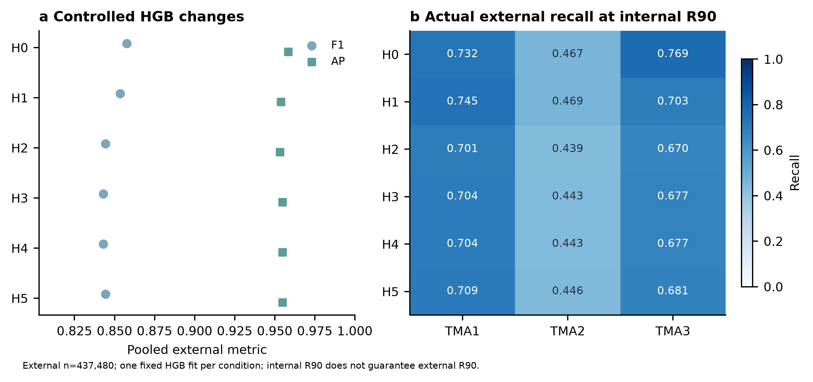
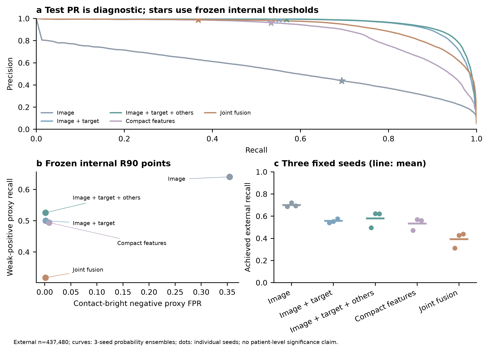
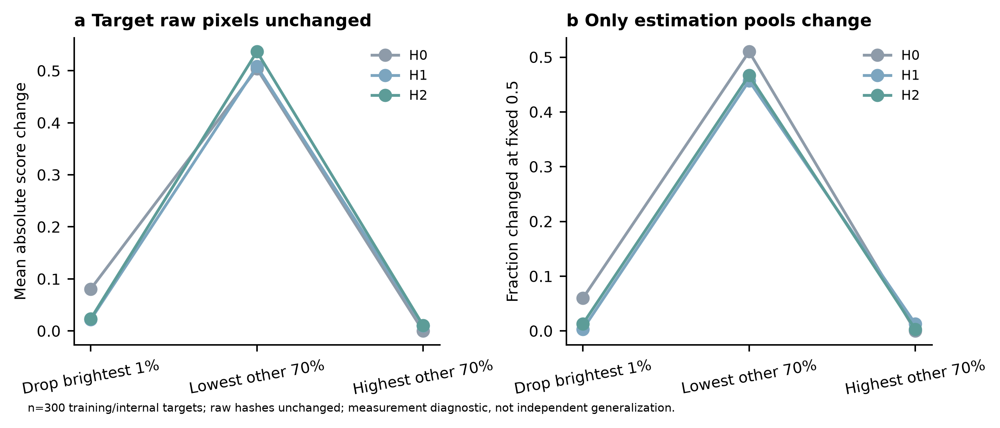
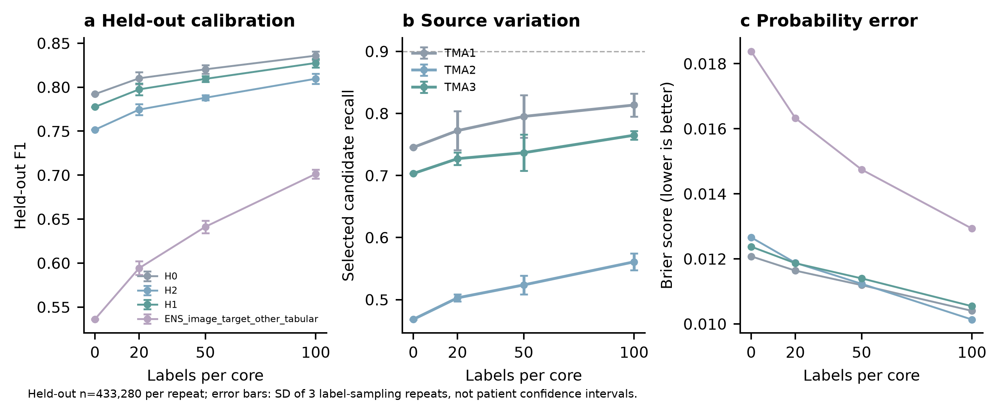

# CD8 representation and target-aware controlled experiments

Seven HGB models and five neural groups with seeds 0/1/2 completed. The original internal-selection rule selected **H1**; this choice and all thresholds remain frozen. The joint target-aware success criterion was **not met**. There was no retraining during correctness revision or publication, and Pan-M was not accessed.

## Population and design

Three training WSIs contained 101,057 labelled cells, three internal WSIs 539,132, and 42 external cores 437,480. Core identifiers are not independent patient identifiers; patient mapping was unavailable. External data had been inspected in historical work, so this is not a prospectively unseen cohort. All formal evaluation uses the full labelled populations. Internal checkpoint sampling was fixed and label blind (up to 10,000 cells per WSI); thresholds and candidate selection used the full internal population.

H0 reproduces legacy E2 (8 intensity + 9 localization features). H1 changes only the common normalization bounds to outer P1/P99. H2 replaces two degenerate localization measures with 13 descriptors; H3 adds train-median imputation and missing indicators; H4 adds a train-fitted normal quantile transform; H5 removes only the indicators from the imputed representation; H6 uses indicators alone as a diagnostic. All preprocessing fits use training data.

Neural groups use the same 96-pixel crop, architecture, nominal 202,306 parameters, paired seed initialization, sampling schedule and budget. The three image inputs are CD8 only, CD8 + target mask, and CD8 + target + other-instance mask. Missing channels/branches are gated to zero. Tabular-only and joint fusion controls are included. Neighbor masks use existing segmentation IDs without label-based selection. Masks are expanded nuclei, not validated cell membranes.

## Full external results at strict score > 0.5

The following neural rows are **three-seed probability ensembles**, not seed metric means. Source: [EXTERNAL_MAIN.csv](../results/EXTERNAL_MAIN.csv), `level=split`, `split=external_val_TMA_cores`, `threshold_mode=fixed_0.5`; columns `precision, recall, F1, AP`.

| Model | Precision | Recall | F1 | AP |
|---|---:|---:|---:|---:|
| H0 / legacy E2 | 0.9608 | 0.7744 | 0.8576 | 0.9584 |
| H1 | 0.9618 | 0.7670 | 0.8534 | 0.9539 |
| H2 | 0.9645 | 0.7508 | 0.8443 | 0.9532 |
| H3 | 0.9639 | 0.7489 | 0.8429 | 0.9548 |
| H4 | 0.9639 | 0.7489 | 0.8429 | 0.9548 |
| H5 | 0.9639 | 0.7512 | 0.8444 | 0.9548 |
| H6 (diagnostic) | 0 | 0 | 0 | 0.1357 |
| ENS image only | 0.6191 | 0.3853 | 0.4750 | 0.5392 |
| ENS image + target | 0.9876 | 0.6740 | 0.8012 | 0.9582 |
| ENS image + target + neighbor | 0.9866 | 0.6940 | 0.8148 | 0.9646 |
| ENS tabular only | 0.8816 | 0.7164 | 0.7905 | 0.8782 |
| ENS fusion | 0.9749 | 0.5956 | 0.7395 | 0.9266 |

H0 remains the strongest external fixed-0.5 F1 baseline in this experiment. H1/H2 do not improve that endpoint. The AP gains with masks apply to this controlled lightweight image ablation; they do not establish general superiority over Nimbus or E2.

## Seed variation and frozen development thresholds

[CONTROLLED_IMAGE_SEED_SUMMARY.csv](CONTROLLED_IMAGE_SEED_SUMMARY.csv) reports mean ± sample SD across seeds, not a patient confidence interval. AP is threshold independent. `dev_recall_90` means a threshold chosen for internal WSI-average recall; it does not guarantee 90% external recall.

| Group | Threshold | Precision | Recall | F1 | AP |
|---|---|---:|---:|---:|---:|
| image | 0.5 | .6085 ± .0138 | .3909 ± .0354 | .4750 ± .0218 | .5319 ± .0055 |
| image | internal R90 | .4289 ± .0157 | .7002 ± .0181 | .5316 ± .0072 | .5319 ± .0055 |
| + target | 0.5 | .9870 ± .0038 | .6709 ± .0452 | .7982 ± .0312 | .9551 ± .0092 |
| + target | internal R90 | .9943 ± .0014 | .5568 ± .0184 | .7138 ± .0150 | .9551 ± .0092 |
| + target + neighbor | 0.5 | .9859 ± .0041 | .6873 ± .0449 | .8093 ± .0304 | .9624 ± .0036 |
| + target + neighbor | internal R90 | .9935 ± .0029 | .5797 ± .0729 | .7303 ± .0591 | .9624 ± .0036 |

At each ensemble's own frozen internal-R90 threshold, weak-positive-proxy recall falls from image-only **0.6404** to target+neighbor **0.5256** (loss 0.1148). Contact-bright-negative-proxy FPR falls from 0.354489 to 0.001516. Overall external recalls also differ (0.6940 versus 0.5682). Thus the predefined ≥20% FPR reduction with ≤0.02 weak-positive recall loss fails; this is not an equal-external-recall improvement. Per-seed references are paired image-only at the same seed: [PAIRED_WEAK_RECALL_REFERENCE.csv](PAIRED_WEAK_RECALL_REFERENCE.csv). The strata are proxies, not new expert-adjudicated labels.

## Composition stress test

The 300 targets came from six training/internal WSIs, 25 reference-negative and 25 reference-positive cells per WSI, with valid old/new intensity features. For each target, other valid instances in the same image were ordered by raw P90; the lowest ceil(70%) plus the target were used to re-estimate normalization bounds. Fixed-0.5 decisions were compared with the same target under the all-instance pool. Raw target/context pixels and masks remained unchanged and hashes were checked.

H0/H1/H2 flipped **153/300 (51.00%), 137/300 (45.67%), 140/300 (46.67%)**. Dropping only the brightest 1% produced 6.00%, 0.33%, 1.33%. This deliberately constructed, label-balanced measurement stress test is not a natural error rate or external generalization estimate. [COMPOSITION_SUMMARY.csv](../results/COMPOSITION_SUMMARY.csv), `pool=lowest_70pct` or `drop_top_1pct`; columns `n_targets,prediction_change_fraction`.

## Separate supervised target-core calibration

For budgets 0/20/50/100 labels per core, three deterministic label-blind nested samples were used. All 100 reserved instances per core were excluded from every budget and baseline, leaving 433,280 evaluation instances per repeat. Only a fixed-penalty logistic intercept was fitted; single-class subsets fall back to the native mapping. This is supervised within-core adaptation, not zero-target-label generalization.

For frozen H1, mean held-out F1 was **0.7776/0.7975/0.8094/0.8275** for 0/20/50/100 labels; mean recall **0.6446/0.6728/0.6902/0.7179**. Variation reflects label sampling, not patient confidence. Do not compare these holdout/development-threshold numbers directly with full-population fixed-0.5 numbers. [TARGET_LABEL_CALIBRATION_SIMULATION.csv](../results/TARGET_LABEL_CALIBRATION_SIMULATION.csv), `model=H1, level=split, stratum is empty (unstratified)`; [concise calibration](CONCISE_CALIBRATION_RESULTS.csv).

## Correctness, provenance and remaining work

The native-dtype strict-threshold repair changed **zero real decisions**, across all recorded repeats/budgets. The 27 model prediction arrays (plus GMM in evaluation) passed length, finite-value, key-order, input/score-hash and unchanged-value checks. Independent checks covered 28 prediction sets and 327 pooled metric rows with maximum numerical difference 1.11e-16. All 22 weights, frozen H1 selection and threshold values were unchanged. [Revision audit](../results/CORRECTNESS_REVISION_AUDIT.json), [dtype audit](../results/CALIBRATION_NATIVE_THRESHOLD_AUDIT.csv), [prediction audit](../results/CORRECTNESS_PREDICTION_AUDIT.csv).

The revised guards atomically save outputs and verify resume metadata; budget accounting distinguishes partial, exhausted and completed runs. They were introduced after this completed training, not retrospectively claimed as original protections. Per-model training/development sum was 2243.09 seconds (original ledger 2243.15); including external inference the recorded total was 2740.78 seconds, below 8 hours. Initialization and epoch-index hashes were reconstructed post hoc, not logged contemporaneously.

The frozen selection rule compared HGB tree-node counts with neural scalar-weight counts; these are not comparable complexity measures. H1 is retained as the outcome of that prespecified rule, not claimed as a fair cross-family complexity optimum. External results did not reselect it.

Eight bilingual scientific PNGs and all 24 exports passed display/hash QA. Thirty-one real cases passed layout QA only; **biological adjudication is pending** and images are excluded from the public repository pending permission. [Review instructions](../review/README.md). The origin of pre-existing exact zeros remains unknown; next work should distinguish label disagreement, segmentation attribution, weak signal and bright-neighbor proxies before designing new acquisition or independent-source validation.
