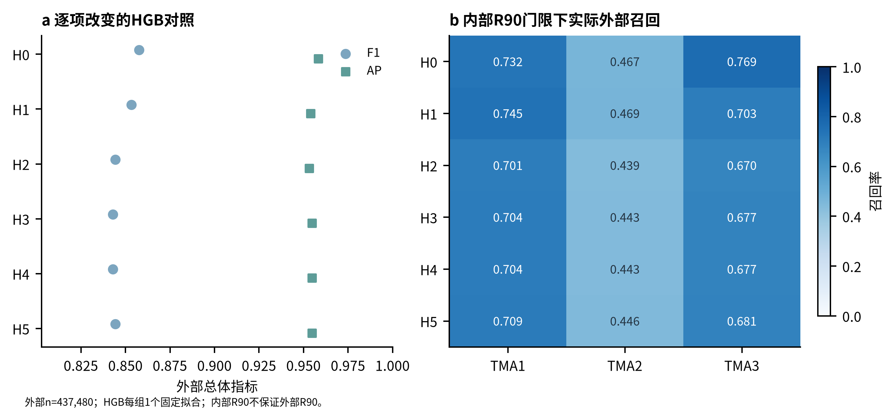
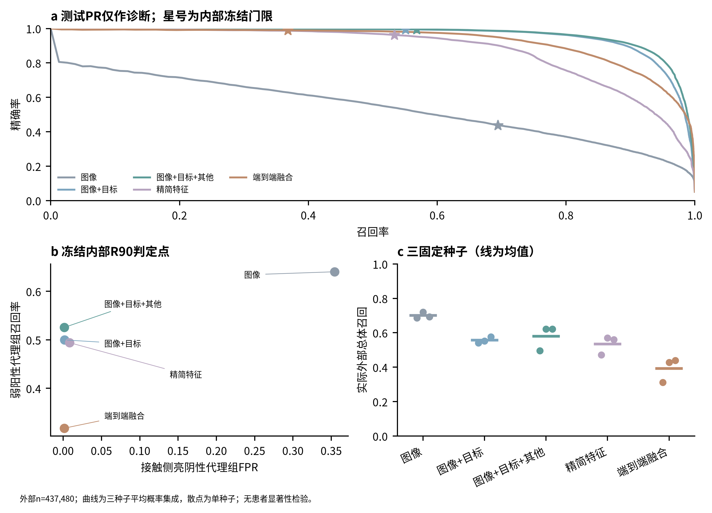
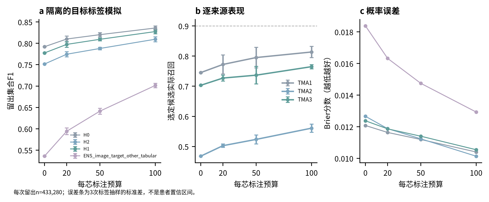
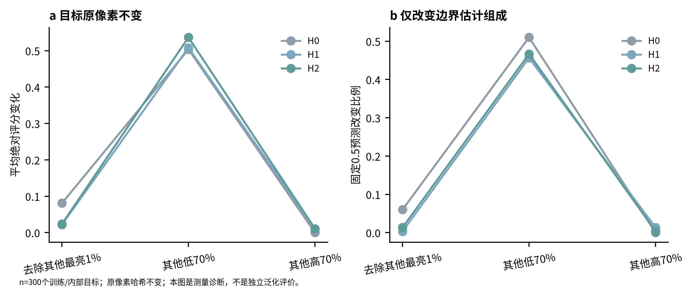

# CD8 marker阴阳性识别：三阶段受控实验报告

三阶段受控计算已完成。按冻结的**完整内部WSI等权AP与复杂度规则**选定候选为 **H1**。外部完整结果全部报告，没有据此重新挑模型、门限或追加搜索。真实病例审阅已导出 **31例**，状态仍是**待用户判读**；计算完成不等于机制问题已经解决。旧代码、分割、标签、权重与历史结果保留，Pan-M持续封存。

## 已完成与评价边界

固定3张训练WSI（101,057有标签细胞）、3张内部WSI（539,132）、42个外部组织芯（437,480）。患者映射缺失，42芯不是42独立患者。主结果保留完整有标签集合；目标标签模拟另列，不与零目标标签泛化混合。网络未观测上下文使用零哨兵，实际有效支持与目标截断单列于CROP_SUPPORT_QC.csv；有限预测不等于完整有效观测。

完成7个固定HGB、5组神经模型各3固定种子。神经模型同96px原尺度crop、同三通道名义结构、同初始化与样本计划、同增强和最大预算；名义参数均202,306，活动参数另列。图像通道统一为CD8、目标实例mask、其他实例mask；缺少的mask通道置零，邻居由已有分割ID产生，不按CD8标签筛选。精简特征与图像的融合为端到端联合训练，没有使用测试分数训练stacking。

120个真实开发细胞的17项E2特征复现、ID和crop检查通过；10项合成验证通过；五组网络的有限损失、梯度、二值mask与配对初始化检查通过。H0旧E2的开发评分和外部混淆矩阵/F1/AP均复现。

神经检查点使用固定、标签盲选的每内部WSI最多10,000实例；完整内部集用于最终候选与判定点开发。内部是开发成绩，本轮没有新OOF。PhenoBIC外部集合已有历史实验曝光，不是前瞻性未见队列。

## 第一步：逐项改变的HGB实验

H0：旧E2的8强度+9定位、原共同min/max边界、原生NaN。
H1：同17特征，只替换成外层P1/P99边界。
H2：同H1，保留其余7项定位，用13项无需MAD描述替换两个退化指标。
H3：H2做训练中位数插补，加缺失标记。
H4：H3再加仅训练拟合的正态分位数变换，标记不变。
H5：H2插补但不加标记；H6：仅标记诊断，不作为部署候选。

H1-H0外部F1变化 **-0.0042**、AP变化 **-0.0045**。H2-H1的F1变化 **-0.0091**、AP变化 **-0.0007**，FP变化 **-63**、FN变化 **+361**。H2检验的是整套修复表征，不把效果归因于单一指标。

新特征包含非零支持率、条件正值强度、边缘/局部参照差、含精确平局处理的序关系。非零支持是测量描述，不等同生物学阳性。无支持和无正值信号分别保留状态，条件均值没有信号时仍为NaN，没有用epsilon制造信息。缺失标记的移除/仅标记对照用于诊断，不能单凭分数证明来源捷径或结构机制。

| model | precision | recall | F1 | AP | tp | fp | fn | n_cells |
| --- | --- | --- | --- | --- | --- | --- | --- | --- |
| H0 | 0.9608 | 0.7744 | 0.8576 | 0.9584 | 17293 | 706 | 5038 | 437480 |
| H1 | 0.9618 | 0.7670 | 0.8534 | 0.9539 | 17128 | 681 | 5203 | 437480 |
| H2 | 0.9645 | 0.7508 | 0.8443 | 0.9532 | 16767 | 618 | 5564 | 437480 |
| H3 | 0.9639 | 0.7489 | 0.8429 | 0.9548 | 16724 | 627 | 5607 | 437480 |
| H4 | 0.9639 | 0.7489 | 0.8429 | 0.9548 | 16724 | 627 | 5607 | 437480 |
| H5 | 0.9639 | 0.7512 | 0.8444 | 0.9548 | 16776 | 629 | 5555 | 437480 |
| ENS_image | 0.6191 | 0.3853 | 0.4750 | 0.5392 | 8604 | 5294 | 13727 | 437480 |
| ENS_image_target | 0.9876 | 0.6740 | 0.8012 | 0.9582 | 15051 | 189 | 7280 | 437480 |
| ENS_image_target_other | 0.9866 | 0.6940 | 0.8148 | 0.9646 | 15498 | 211 | 6833 | 437480 |
| ENS_tabular_only | 0.8816 | 0.7164 | 0.7905 | 0.8782 | 15999 | 2149 | 6332 | 437480 |
| ENS_image_target_other_tabular | 0.9749 | 0.5956 | 0.7395 | 0.9266 | 13301 | 343 | 9030 | 437480 |
| GMM | 0.6547 | 0.9086 | 0.7610 | 0.8302 | 20290 | 10703 | 2041 | 437480 |

以上均为严格score>0.5的外部描述性结果。三种子集成与单种子结果分别保存；集成没有新增拟合。NEURAL_SEED_SUMMARY.csv记录种子间描述性均值/标准差，不是患者置信区间。输入状态的统计分母为相应有标签集合，详见INPUT_QUALITY_LABELLED_POPULATION.csv；不与旧438,236个外部全实例分母混用。

## 第二步：目标归属与误报/漏报权衡

冻结内部R90判定点下，图像+目标+其他实例的集成相对图像分支：接触侧亮阴性代理组FPR相对变化 **-99.6%**，弱阳性代理组召回变化 **-0.1148**。预注册描述性标准“FPR至少下降20%，弱阳性召回损失不超过0.02”：**未满足**。实际外部总体召回分别为 **0.6940**、**0.5682**，需同时解释。

测试PR曲线只作诊断，星号来自内部冻结门限。误报减少不能自动证明真实邻居污染被消除。当前mask为expanded_nucleus，边缘不是验证过的真实细胞膜；真实物理像素间距未知，crop和尺度条仅用像素。

## 第三步：判定点迁移与目标标签模拟

内部目标召回不保证外部达到同等召回。下表为冻结内部R90门限下的实际来源表现，完整逐芯表保留。

| model | context | threshold | precision | recall | F1 | AP |
| --- | --- | --- | --- | --- | --- | --- |
| H0 | TMA1_CD8 | 0.9320 | 0.9830 | 0.7320 | 0.8391 | 0.9726 |
| H0 | TMA2_CD8 | 0.9320 | 0.9828 | 0.4670 | 0.6332 | 0.9422 |
| H0 | TMA3_CD8 | 0.9320 | 0.9815 | 0.7691 | 0.8624 | 0.9755 |
| H1 | TMA1_CD8 | 0.9360 | 0.9740 | 0.7455 | 0.8445 | 0.9681 |
| H1 | TMA2_CD8 | 0.9360 | 0.9805 | 0.4692 | 0.6347 | 0.9321 |
| H1 | TMA3_CD8 | 0.9360 | 0.9851 | 0.7030 | 0.8205 | 0.9718 |
| H2 | TMA1_CD8 | 0.9420 | 0.9787 | 0.7007 | 0.8167 | 0.9671 |
| H2 | TMA2_CD8 | 0.9420 | 0.9827 | 0.4391 | 0.6069 | 0.9267 |
| H2 | TMA3_CD8 | 0.9420 | 0.9865 | 0.6700 | 0.7980 | 0.9715 |

目标标签模拟按每芯20/50/100标签、3个固定哈希重复，抽样不使用标签且预算嵌套。每芯预留全部100实例，从所有预算及零预算基线的评价中排除；每次留出433,280实例。只拟合固定L2惩罚的logistic截距，单类校准子集回退原映射。它是监督的芯内适配模拟，不是零目标标签泛化或独立患者验证。

| budget_per_core | F1_mean | F1_std | recall_mean | recall_std | FPR_mean | FPR_std | Brier_mean | Brier_std |
| --- | --- | --- | --- | --- | --- | --- | --- | --- |
| 0 | 0.7776 | 0.0002 | 0.6446 | 0.0003 | 0.0007 | 0.0000 | 0.0124 | 0.0000 |
| 20 | 0.7975 | 0.0066 | 0.6728 | 0.0096 | 0.0008 | 0.0000 | 0.0119 | 0.0001 |
| 50 | 0.8094 | 0.0033 | 0.6902 | 0.0052 | 0.0008 | 0.0000 | 0.0114 | 0.0002 |
| 100 | 0.8275 | 0.0049 | 0.7179 | 0.0078 | 0.0009 | 0.0000 | 0.0105 | 0.0003 |

误差条为3次标签抽样标准差，不是生物学置信区间。每次每芯20/50/100对应全42芯840/2,100/4,200标签。TEST_ONLY_THRESHOLD_DIAGNOSTIC.csv中的测试来源专用门限仅作诊断，没有回写部署门限或选模。

## 组成依赖诊断

300个训练/内部目标保持原像素和mask不变，仅改变参与边界估计的其他实例组成，产生3,600条评分记录。原像素哈希与完整组成条件下的评分复现均通过。这是测量过程的组成敏感性诊断，不是独立泛化评价，也不是重复旧9600细胞的亮度/旋转检查。

| model | pool | n_targets | mean_abs_score_delta | max_abs_score_delta | prediction_change_fraction |
| --- | --- | --- | --- | --- | --- |
| H0 | all | 300 | 0.0000 | 0.0000 | 0.0000 |
| H0 | drop_top_1pct | 300 | 0.0807 | 0.8036 | 0.0600 |
| H0 | highest_70pct | 300 | 0.0000 | 0.0000 | 0.0000 |
| H0 | lowest_70pct | 300 | 0.5037 | 0.9947 | 0.5100 |
| H1 | all | 300 | 0.0000 | 0.0000 | 0.0000 |
| H1 | drop_top_1pct | 300 | 0.0220 | 0.4954 | 0.0033 |
| H1 | highest_70pct | 300 | 0.0099 | 0.2723 | 0.0133 |
| H1 | lowest_70pct | 300 | 0.5081 | 0.9911 | 0.4567 |
| H2 | all | 300 | 0.0000 | 0.0000 | 0.0000 |
| H2 | drop_top_1pct | 300 | 0.0237 | 0.6070 | 0.0133 |
| H2 | highest_70pct | 300 | 0.0109 | 0.2661 | 0.0033 |
| H2 | lowest_70pct | 300 | 0.5365 | 0.9936 | 0.4667 |

## 待用户判读与仍未知的问题

打开[真实病例复核说明](../review/README.md)，在CASE_REVIEW.csv填写user_decision、segmentation_issue、reviewer_confidence和reviewer_notes。病例是预定义平衡来源/错误代理的说明性抽样，不用于估计总体错误率。原CD8 crop、实例mask和有效支持保留在NPZ；采用单位共同U的线性显示范围，无局部选择性增强。自动代理、原参考标签和自行查看都不冒充新增专家复核。

发布版输入中的大量零值原已存在，其上游背景扣除、阈值化或量化来源仍未知。本轮不能给出物理成因。下一步优先用真实病例判读区分参考标签争议、分割归属异常、真实弱信号与亮邻居代理，再决定新增原始成像或独立来源验证。旧E2保留为强基线，不自动替换既有模型。

## 时间、资源与复现

神经训练/开发推理及外部推理累计保守墙钟预算计数 **0.76小时**，上限8小时；不是纯GPU算子计时。每模型/分块实际耗时、进程RSS和GPU峰值单独保存。

完整权重、真实crop缓存和逐细胞预测留服务器新实验目录；E盘轻量包包含代码、配置、汇总CSV、图和病例。REPRODUCE.md给出环境与命令。完成标志包括FEATURES_COMPLETE、HGB_COMPLETE、NEURAL_COMPLETE、MODEL_SELECTION_FROZEN、COMPOSITION_COMPLETE、EVALUATION_COMPLETE、REVIEW_COMPLETE。该句描述实验执行时状态；2026-11-01 的用户授权仓库发布另见版本索引。

## 正确性修订与保留限制

本次修订未重新训练，22个模型权重、全部逐细胞分数、冻结候选 **H1** 和阈值数值均保持不变。27组预测数组已逐一核验长度、有限值、四键顺序、输入与分数哈希，并与原逐细胞表一致；写入现采用原子替换和独立完成元数据。

校准评价统一使用原分数dtype对应的有效阈值，零标注预算与单类别回退均逐实例核验为原严格“>”判定。旧实现在零预算下造成的判定差异计数为 **0**（三次抽样重复累加，不是独立细胞数）。所有校准预算、图和报告已重算；各预算与未校准基线共同排除每core预留100例。

训练及完整内部推理累计 **2243.09秒**，加外部推理为 **2740.78秒**，未触及8小时。新的执行保护区分partial、budget_exhausted、completed；这些保护未用于本次已完成训练，不倒称为当时已有。

正式seed初始化和每epoch 50,000训练索引哈希是**训练后按原确定性算法重建**，不是当时记录。seed 0与当时冒烟初始化哈希一致；固定30,000内部验证索引与保存文件完全一致。训练抽样各seed/epoch不同，同seed同epoch各组相同；最终阈值和评价使用完整内部/外部集合。

原内部筛选规则已冻结并保留，但复杂度排序将HGB树节点数与神经标量权重数直接比较，两者量纲不同，存在跨模型族偏向；因此候选仅代表该预定规则的结果，不应解释为公平的模型复杂度最优。外部结果未用于重选。Pan-M保持封存，真实病例仍待人工复核。

## 三种图像输入的可解释比较

以下是同一轻量编码器、相同训练预算下的受控比较。均值±标准差来自3个固定seed；这是训练随机性波动，不是患者置信区间。三seed平均概率集成的指标另列，不与单seed均值混用。AP提升的结论限于本轮image-only与mask输入的对照；本实验没有据此建立相对Nimbus或其他方法的普遍优势，旧E2/H0的固定0.5 F1仍较高。

| group              | threshold_mode   | precision       | recall          | F1              | AP              |
|:-------------------|:-----------------|:----------------|:----------------|:----------------|:----------------|
| image              | dev_recall_90    | 0.4289 ± 0.0157 | 0.7002 ± 0.0181 | 0.5316 ± 0.0072 | 0.5319 ± 0.0055 |
| image              | fixed_0.5        | 0.6085 ± 0.0138 | 0.3909 ± 0.0354 | 0.4750 ± 0.0218 | 0.5319 ± 0.0055 |
| image_target       | dev_recall_90    | 0.9943 ± 0.0014 | 0.5568 ± 0.0184 | 0.7138 ± 0.0150 | 0.9551 ± 0.0092 |
| image_target       | fixed_0.5        | 0.9870 ± 0.0038 | 0.6709 ± 0.0452 | 0.7982 ± 0.0312 | 0.9551 ± 0.0092 |
| image_target_other | dev_recall_90    | 0.9935 ± 0.0029 | 0.5797 ± 0.0729 | 0.7303 ± 0.0591 | 0.9624 ± 0.0036 |
| image_target_other | fixed_0.5        | 0.9859 ± 0.0041 | 0.6873 ± 0.0449 | 0.8093 ± 0.0304 | 0.9624 ± 0.0036 |

三seed平均概率集成的实际工作点（R90指内部开发集选择要求，不代表外部达到90%）：

| model                  | threshold_mode   |   threshold |   precision |   recall |     F1 |     AP |
|:-----------------------|:-----------------|------------:|------------:|---------:|-------:|-------:|
| ENS_image              | fixed_0.5        |      0.5000 |      0.6191 |   0.3853 | 0.4750 | 0.5392 |
| ENS_image              | dev_recall_90    |      0.1920 |      0.4378 |   0.6940 | 0.5369 | 0.5392 |
| ENS_image_target       | fixed_0.5        |      0.5000 |      0.9876 |   0.6740 | 0.8012 | 0.9582 |
| ENS_image_target       | dev_recall_90    |      0.7930 |      0.9947 |   0.5509 | 0.7091 | 0.9582 |
| ENS_image_target_other | fixed_0.5        |      0.5000 |      0.9866 |   0.6940 | 0.8148 | 0.9646 |
| ENS_image_target_other | dev_recall_90    |      0.8070 |      0.9950 |   0.5682 | 0.7233 | 0.9646 |

弱阳性成功标准以同seed的image-only为参照，各组使用各自冻结的内部R90阈值。逐seed差值见 PAIRED_WEAK_RECALL_REFERENCE.csv。集成层面，image-only弱阳性召回0.6404，对比target+neighbor的0.5256，下降0.1148；实际外部总体召回也不同，因此不能将误报减少称作外部同召回下的提升。预设“误报降低且弱阳性损失≤0.02”的联合标准未通过。

## 组成依赖压力测试的分母与边界

目标集合是3张训练WSI与3张内部验证WSI的300个预选细胞：每张25个参考阴性、25个参考阳性，并要求旧/新强度特征有效。逐目标在同一图像内对其他有效实例按原始细胞P90排序，仅取最低70%（数量向上取整）后加回目标，重新估计归一化上下界，再与该目标使用全部有效实例估计边界时的固定0.5判定比较。目标及局部原始像素不变，像素哈希已核验。

翻转数：H0为153/300（51.00%）；H1为137/300（45.67%）；H2为140/300（46.67%）。这是有意构造的归一化压力测试，目标按标签平衡抽取，不代表自然图像的错误率或阳性比例，也不是外部泛化评价。

## 仓库发布索引（2026-11-01）

本报告来自 correctness_001 最终交付版，仅补充仓库入口、证据链接和发布范围；结果数值未改。真实病例像素、实例级清单和私人交付回执不公开。

- [表格索引](../TABLE_INDEX.csv)与[结论索引](../CONCLUSION_INDEX.csv)列出每项证据及筛选条件。
- [外部全模型结果](../results/EXTERNAL_MAIN.csv)：`split=external_val_TMA_cores, level=split`；`fixed_0.5` 与 `dev_recall_90` 分开读取。
- [三 seed 均值/标准差](CONTROLLED_IMAGE_SEED_SUMMARY.csv)与[弱阳性配对参照](PAIRED_WEAK_RECALL_REFERENCE.csv)；ENS 是先平均概率再算指标，不是指标均值。
- [组成汇总](../results/COMPOSITION_SUMMARY.csv)：`pool=lowest_70pct`；H0/H1/H2 分母各 300，翻转 153/137/140。
- [独立目标标签校准](../results/TARGET_LABEL_CALIBRATION_SIMULATION.csv)：每个预算共同排除各芯预留 100 例，`level=split, stratum is empty (unstratified)`。
- [修订审计](../results/CORRECTNESS_REVISION_AUDIT.json)、[dtype 逐预算审计](../results/CALIBRATION_NATIVE_THRESHOLD_AUDIT.csv)、[预测审计](../results/CORRECTNESS_PREDICTION_AUDIT.csv)与[展示 QA](VISUAL_QA.json)。
- [可移植配置与复现边界](../README.md)、[公开版本索引](../VERSION_INDEX.csv)、[英文报告](REPORT_en.md)。
