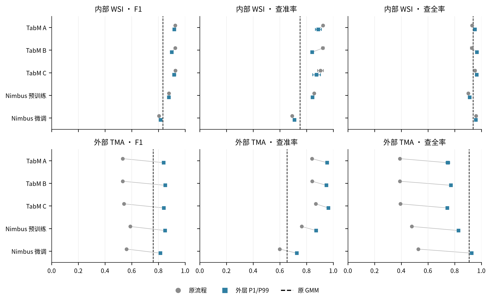
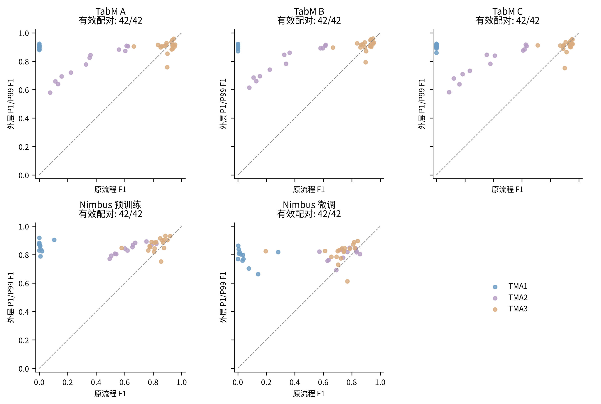
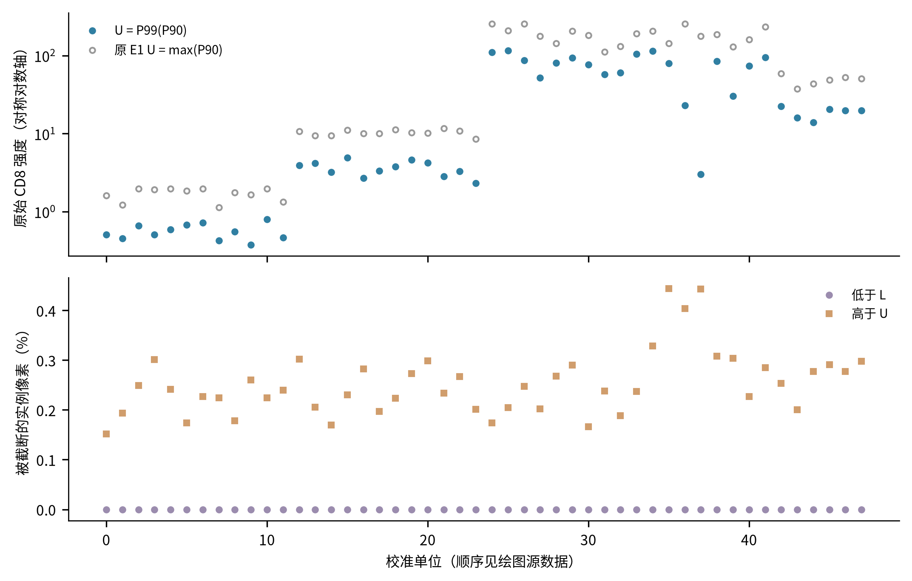
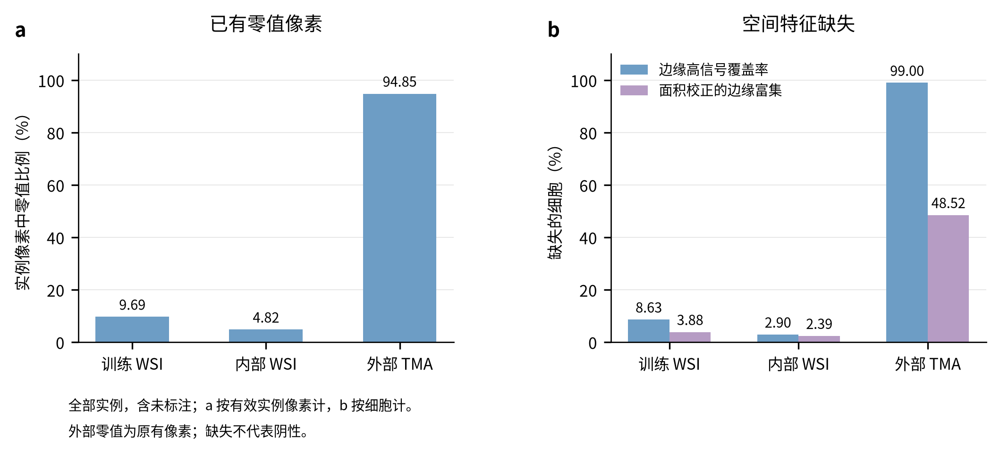

# CD8：外层百分位校准后的 TabM 与 Nimbus 重训练

本报告仅记录本轮已完成的 PhenoBIC CD8 实验。原 GMM、原 TabM 和原 Nimbus 结果直接复用；Pan-M 未读取。

## 方法与交付状态

逐实例原始像素先取 P10/P90，再在每个原始 WSI（内部验证去除重复 FOV）或单个 TMA 组织芯内，分别取所有合格实例的 P1/P99 得到 L/U。所有像素共用 `clip((I-L)/(U-L),0,1)`；外层尾部实例仍保留。校准不读取标签。

TabM A/B/C 分别使用 8/27/90 项特征；本轮没有因全缺失或常量而剔除输入列，实际输入顺序保存在各模型冻结配置中。正式结果为种子 0/1/2 的均值；图中误差线为这三个种子的样本标准差。Nimbus 包含官方 V1 在新尺度下直接推理，以及从 V1 重新微调两个结果，各使用一个种子。匹配 HGB 对照保留在完整 CSV 中。

固定 `score > 0.5` 是主比较；验证集所选门限单列，未与固定门限混排。训练、验证、外部划分及细胞 ID 保持不变。扩张核 mask 的边缘仍是近似细胞边缘。
内部 WSI 用于早停、学习率和门限选择，内部表展示开发表现；外部数据沿用官方分组作本轮比较。

GMM 是按图拟合的无监督基线；TabM 和 Nimbus 微调使用原训练 WSI 的人工标签。逐芯若没有真阳性，Recall/AP 为 NaN，单一真值类别时 ROC-AUC 为 NaN；没有预测阳性时 Precision=0，F1 仅在其分母非零时计算。这与两套原评价函数一致。

## 固定 0.5 门限的性能

### 内部 WSI

| 排序 | 模型 | Precision | Recall | F1 | AP | F1 − GMM |
| --- | --- | --- | --- | --- | --- | --- |
| 1 | TabM A | 0.8886 | 0.9524 | 0.9192 | 0.9808 | 0.0848 |
| 2 | TabM C | 0.8753 | 0.9659 | 0.9181 | 0.9836 | 0.0837 |
| 3 | TabM B | 0.8423 | 0.9666 | 0.9002 | 0.9801 | 0.0658 |
| 4 | Nimbus 预训练 | 0.8453 | 0.9130 | 0.8779 | 0.9438 | 0.0435 |
| 5 | GMM | 0.7513 | 0.9382 | 0.8344 | 0.9481 | 0.0000 |
| 6 | Nimbus 微调 | 0.7094 | 0.9594 | 0.8157 | 0.9118 | -0.0187 |

来源：[MAIN_FIXED_0_5.csv](report_tables/MAIN_FIXED_0_5.csv)，筛选 `split=internal_val_WSIs`、`variant=new/baseline`、`model_family≠HGB`；列为 `precision_mean/recall_mean/f1_mean/average_precision_mean`。排序表为 [RANK_internal_val_WSIs.csv](report_tables/RANK_internal_val_WSIs.csv)。

### 外部 TMA

| 排序 | 模型 | Precision | Recall | F1 | AP | F1 − GMM |
| --- | --- | --- | --- | --- | --- | --- |
| 1 | TabM B | 0.9491 | 0.7725 | 0.8518 | 0.9451 | 0.0907 |
| 2 | Nimbus 预训练 | 0.8717 | 0.8291 | 0.8499 | 0.9257 | 0.0889 |
| 3 | TabM C | 0.9637 | 0.7454 | 0.8406 | 0.9576 | 0.0796 |
| 4 | TabM A | 0.9544 | 0.7491 | 0.8393 | 0.9482 | 0.0783 |
| 5 | Nimbus 微调 | 0.7273 | 0.9278 | 0.8154 | 0.8909 | 0.0544 |
| 6 | GMM | 0.6547 | 0.9086 | 0.7610 | 0.8302 | 0.0000 |

来源：[MAIN_FIXED_0_5.csv](report_tables/MAIN_FIXED_0_5.csv)，筛选 `split=external_val_TMA_cores`、`variant=new/baseline`、`model_family≠HGB`；列为 `precision_mean/recall_mean/f1_mean/average_precision_mean`。排序表为 [RANK_external_val_TMA_cores.csv](report_tables/RANK_external_val_TMA_cores.csv)。

## 新旧流程的配对变化

| 模型 | 原 F1 | 新 F1 | ΔF1 | ΔAP | ΔTP | ΔFP | ΔFN |
| --- | --- | --- | --- | --- | --- | --- | --- |
| Nimbus 微调 | 0.5611 | 0.8154 | 0.2543 | 0.3331 | 8938.0000 | -107.0000 | -8938.0000 |
| Nimbus 预训练 | 0.5885 | 0.8499 | 0.2613 | 0.2857 | 7821.0000 | -590.0000 | -7821.0000 |
| TabM A | 0.5325 | 0.8393 | 0.3068 | 0.1892 | 8024.6667 | -855.3333 | -8024.6667 |
| TabM B | 0.5328 | 0.8518 | 0.3190 | 0.2574 | 8549.0000 | -708.0000 | -8549.0000 |
| TabM C | 0.5423 | 0.8406 | 0.2983 | 0.2870 | 7846.0000 | -693.6667 | -7846.0000 |

来源：[EXTERNAL_PAIRED_CHANGES.csv](report_tables/EXTERNAL_PAIRED_CHANGES.csv)，外部整体、固定 0.5；正的 ΔF1/ΔAP 表示改善。TP/FP/FN 是种子间平均计数的变化，因此可能为小数，并非合并重复细胞。

- Nimbus 微调：外部 F1 提高 0.2543，AP 变化 +0.3331；依据同表 `f1_delta/average_precision_delta`。
- Nimbus 预训练：外部 F1 提高 0.2613，AP 变化 +0.2857；依据同表 `f1_delta/average_precision_delta`。
- TabM A：外部 F1 提高 0.3068，AP 变化 +0.1892；依据同表 `f1_delta/average_precision_delta`。
- TabM B：外部 F1 提高 0.3190，AP 变化 +0.2574；依据同表 `f1_delta/average_precision_delta`。
- TabM C：外部 F1 提高 0.2983，AP 变化 +0.2870；依据同表 `f1_delta/average_precision_delta`。

### 逐 TMA 与组织芯

| TMA | 模型 | ΔF1 | ΔAP | ΔRecall | ΔFP | ΔFN |
| --- | --- | --- | --- | --- | --- | --- |
| TMA1_CD8 | Nimbus 微调 | 0.7928 | 0.5940 | 0.9360 | 2777.0000 | -6810.0000 |
| TMA2_CD8 | Nimbus 微调 | 0.1220 | 0.0652 | 0.3515 | 1915.0000 | -2414.0000 |
| TMA3_CD8 | Nimbus 微调 | 0.1547 | 0.0824 | -0.0349 | -4799.0000 | 286.0000 |
| TMA1_CD8 | Nimbus 预训练 | 0.8516 | 0.4658 | 0.8525 | 1045.0000 | -6203.0000 |
| TMA2_CD8 | Nimbus 预训练 | 0.2379 | 0.0581 | 0.3447 | 561.0000 | -2367.0000 |
| TMA3_CD8 | Nimbus 预训练 | 0.0560 | 0.0363 | -0.0915 | -2196.0000 | 749.0000 |
| TMA1_CD8 | TabM A | 0.8932 | 0.0302 | 0.8520 | 405.6667 | -6199.0000 |
| TMA2_CD8 | TabM A | 0.4660 | -0.0032 | 0.4145 | 106.6667 | -2846.6667 |
| TMA3_CD8 | TabM A | 0.0045 | 0.0061 | -0.1247 | -1367.6667 | 1021.0000 |
| TMA1_CD8 | TabM B | 0.8973 | 0.2669 | 0.8645 | 453.6667 | -6290.3333 |
| TMA2_CD8 | TabM B | 0.4884 | -0.0008 | 0.4426 | 118.3333 | -3039.6667 |
| TMA3_CD8 | TabM B | 0.0169 | 0.0049 | -0.0954 | -1280.0000 | 781.0000 |
| TMA1_CD8 | TabM C | 0.8887 | 0.2594 | 0.8328 | 299.6667 | -6059.6667 |
| TMA2_CD8 | TabM C | 0.4579 | 0.0614 | 0.4130 | 98.3333 | -2836.0000 |
| TMA3_CD8 | TabM C | -0.0110 | 0.0001 | -0.1282 | -1091.6667 | 1049.6667 |

[PAIRED_CONTEXT_CHANGES.csv](report_tables/PAIRED_CONTEXT_CHANGES.csv) 按 `context=TMA1_CD8/TMA2_CD8/TMA3_CD8` 和 `threshold_mode` 查看；`average_precision_delta/recall_delta/fp_delta/fn_delta` 分别对应可分性、召回、误报与漏检变化。完整组织芯数据见 [PAIRED_CHANGES.csv](results/PAIRED_CHANGES.csv)，筛选 `level=image`。

## 校准与数据完整性

校准共 48 个单位，失效 0 个。按唯一实例的有限像素数加权，低于 L 的像素占 0.0000%，高于 U 占 0.2548%。分母不包含背景，不重复计算重叠 FOV 中的同一实例。来源：[calibration_clipping.csv](figure_source/calibration_clipping.csv)，计数列 `calibration_invalid/finite_instance_pixels`，比例列 `fraction_below_L/fraction_above_U`。

此处限制的是参与尺度边界估计的极端细胞，而不是删除极端细胞。更稳健的尺度仍可能压缩很亮像素的差异；模型性能的实际方向由上面的配对表判断。

完整评分覆盖率见 [MODEL_COMPARISON.csv](results/MODEL_COMPARISON.csv) 的 `n_cells/n_score_finite/n_score_failed/prediction_coverage`；校准有效性另见 `n_calibration_invalid/calibration_coverage`。插补后得到有限分数不等于图像校准有效，两者分别保留。不完整评分组不进入完整集合 F1 排序。局部空间特征的 NaN 保留，并按各模型原定训练预处理处理。

## 输入稀疏性与特征缺失

图中统计全部实例，包含未标注细胞。图 a 的分母是去重且有效的实例掩码内有限像素；图 b 的分母是细胞数，均不同于正式分类指标的有标签细胞分母。绘图数值、计数、分母及逐行筛选条件见 `report_tables/DATA_QUALITY_PLOT_DATA.csv`。

训练、内部、外部的零像素比例依次为 9.6871%、4.8156%、94.8541%。来源：`report_tables/DATA_QUALITY_CLIPPING.csv`，筛选 `aggregation=split` 和对应 `split`，列 `at_zero_percent,finite_instance_pixels`。外部 L 均为 0，严格低于 L 的像素数为 0（同表外部行 `all_L_equal_zero,below_L_pixel_count`），所以高零值比例原本就存在；它不是本轮下界裁剪新造的零值，也不是细胞阴性率。

外部覆盖率缺失由 98.9976% 变为 98.9985%（新增 4，恢复 0）；富集缺失由 48.5161% 变为 48.5163%（新增 3，恢复 2）。新增缺失仅占很小部分，高缺失主要继承原数据及固定参照规则。来源：`report_tables/DATA_QUALITY_MISSINGNESS.csv`，筛选 `aggregation=split, split=external_val_TMA_cores` 及 `feature=high_signal_edge_coverage/edge_signal_enrichment`，列 `old_missing_percent,new_missing_percent,newly_missing,recovered`。

在图 b 的两项特征中，参照 MAD=0（或不高于数值 epsilon）只直接限制高信号覆盖率；边缘富集不因 MAD=0 自动缺失，它还要求足够的参照、edge/inner 支持及校正总信号。NaN 不代表阴性，也不能单凭这些代理确认邻居污染。

## 补充门限、错误类型与复现

验证集门限结果：[VALIDATION_THRESHOLD.csv](report_tables/VALIDATION_THRESHOLD.csv)，筛选 `split` 和 `model_family/feature_set`；门限与性能列分别为 `threshold_mean`、`f1_mean/precision_mean/recall_mean/average_precision_mean`。各个种子的门限和结果保存在 [MODEL_COMPARISON.csv](results/MODEL_COMPARISON.csv)。

弱阳性、邻近亮细胞、局部背景等预定错误分层、实例图和资源耗时见 [TabM 报告](../cd8_tabm_robust_20261030/ANALYSIS_REPORT.md) 与 [Nimbus 报告](../cd8_nimbus_robust_20261030/ANALYSIS_REPORT.md)。这些分层沿用原训练集定义。整体 FP 下降不能单独证明邻近污染已解决。

复现命令与运行顺序见 [README](README.md)。源代码、参数与结果哈希分别由 [RETRAIN_PROTOCOL.json](RETRAIN_PROTOCOL.json)、各模型冻结协议和 `COMPARISON_COMPLETE.json/REPORT_COMPLETE.json` 绑定。

全量文件保留在服务器：

- 归一化逐细胞特征：`/mnt/disk3/mIHC/mif_marker_positivity_20261022/analyses/cd8_robust_calibration_20261030/PhenoBIC_CD8_features.parquet`。
- TabM 模型、全部子模型预测及逐细胞结果：`/mnt/disk3/mIHC/mif_marker_positivity_20261022/analyses/cd8_tabm_robust_20261030`。
- Nimbus 权重及逐细胞结果：`/mnt/disk3/mIHC/mif_marker_positivity_20261022/analyses/cd8_nimbus_robust_20261030`。

TabM 三种子和 Nimbus 单种子的计算条件不同，排序是本次实际配置的描述结果；未开展细胞级显著性检验。Nimbus 新尺度流程属于任务适配，不宣称复现整篇论文全部实验。
