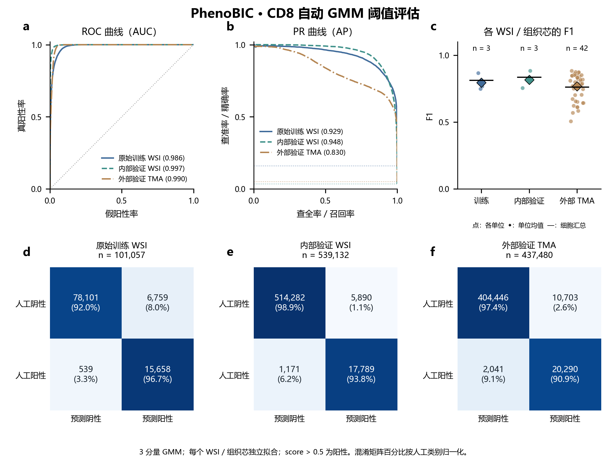

# SCIMAP GMM：PhenoBIC CD8

原 GMM 已完成。本页为发布时从原有 CSV 整理的 Markdown 摘要，不重新拟合或调整门限。

## 方法

按原 WSI 或独立 TMA core 无监督拟合。原始实例像素的 CD8 均值经固定 SCIMAP 流程得到 `rescale_score`，严格 `score > 0.5` 判阳；评分不称为已校准阳性概率。标签只用于评价，以显式 cell_id 对应。内部 FOV 按原坐标重建、重叠像素去重。Pan-M 未用于本轮分析。

配置见 [PROTOCOL.json](PROTOCOL.json)，源码固定信息见 [scimap_provenance.json](provenance/scimap_provenance.json)。

## 结果

| split | n | Precision | Recall | F1 | AP |
|---|---:|---:|---:|---:|---:|
| training_WSIs | 101057 | 0.6985 | 0.9667 | 0.8110 | 0.9289 |
| internal_val_WSIs | 539132 | 0.7513 | 0.9382 | 0.8344 | 0.9481 |
| external_val_TMA_cores | 437480 | 0.6547 | 0.9086 | 0.7610 | 0.8302 |

来源：[metrics_summary.csv](results/phenobic/metrics_summary.csv)，筛选 `level=split`；列为表头对应的 `n_evaluated,precision,recall,F1,AP`。逐组织芯和逐 WSI 见 [metrics_per_unit.csv](results/phenobic/metrics_per_unit.csv)。混淆矩阵、AUC、阳性比例和宏平均均保留在原汇总 CSV 中。

## 解释与复现

原始划分保持不变；mask 为扩张核，不能解释为经验证真实膜。患者映射不足时以切片分组；组织芯不代表独立患者。内部／外部结果属于既有公开队列分析，不称从未查看的前瞻性验证。

实际运行版本为 `extract_cd8_v2.py` 与 `analyze_cd8_v2.py`，依赖与使用见 [README_ANALYSIS.txt](README_ANALYSIS.txt)。完整细胞表留在服务器，Git 只保留汇总结果和路径索引。后续 Nimbus 比较对原 GMM 分数和预测进行了零差异复核，见 [GMM_reuse_audit.csv](../cd8_nimbus_20261024/results/GMM_reuse_audit.csv)。
